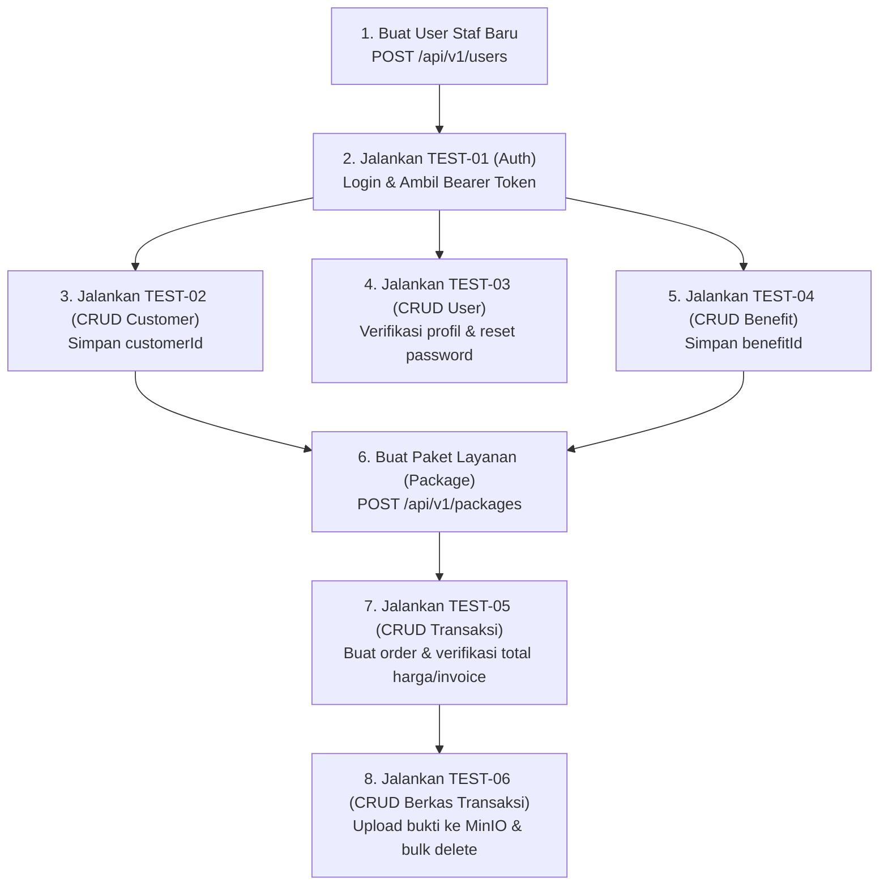

# Katalog Issue Testing: End-to-End & API Functional Testing

Dokumen ini berisi spesifikasi issue/tiket tugas pengujian (*API & Functional Testing*) untuk backend **Nuy Laundry**. Dibuat dengan format **high-level, jelas, dan terstruktur** agar mudah dipahami serta dieksekusi oleh *junior developer*, QA engineer, maupun agen AI otomatis (seperti model bahasa ringan/hemat biaya) menggunakan tools seperti Postman, Bruno, cURL, REST Client, atau automated E2E test scripts.

---

## 1. Panduan Lingkungan & Prasyarat Pengujian (Prerequisites)

Sebelum menjalankan pengujian terhadap endpoint-endpoint di bawah ini, pastikan:

1. **Layanan Pendukung Aktif (Docker Containers)**:
   ```bash
   docker compose up -d
   ```
   Pastikan keempat container berikut berstatus *Up/Healthy*:
   - `nuy-laundry-postgres` (Port 5432)
   - `nuy-laundry-redis` (Port 6379)
   - `nuy-laundry-minio` (Port 9000 untuk API S3, Port 9001 untuk Web Console)
   - `nuy-laundry-rabbitmq` (Port 5672)

2. **Aplikasi Backend Berjalan**:
   ```bash
   ./mvnw spring-boot:run
   ```
   Base URL aplikasi default: `http://localhost:8080`

3. **Format Standar Respon API**:
   - **Sukses**:
     ```json
     {
       "code": 200,
       "status": true,
       "message": "SUCCESS",
       "errors": null,
       "data": { ... }
     }
     ```
   - **Validasi Gagal (HTTP 400)**:
     ```json
     {
       "code": 400,
       "status": false,
       "message": "Request validation",
       "errors": {
         "fieldName": ["Pesan error"]
       },
       "data": null
     }
     ```
   - **Error Logika/Data (HTTP 401 / 403 / 404 / 409)**:
     ```json
     {
       "code": 404,
       "status": false,
       "message": "Customer tidak ditemukan",
       "errors": null,
       "data": null
     }
     ```

4. **Konvensi Header HTTP**:
   - Request JSON biasa: `Content-Type: application/json`
   - Request Upload Berkas: `Content-Type: multipart/form-data`
   - Endpoint terproteksi: `Authorization: Bearer <access_token>`

---

## 2. Ringkasan Daftar Issue Testing

| Issue ID | Fitur / Modul | Target Endpoint Utama | Tipe Request | Ketergantungan Data |
| :--- | :--- | :--- | :--- | :--- |
| **TEST-01** | Autentikasi & Sesi | `/api/auth/login`, `/api/auth/refresh-token` | `application/json` | Membutuhkan user terdaftar di sistem |
| **TEST-02** | CRUD Customer | `/api/v1/customers/**` | `application/json` | Bearer Token |
| **TEST-03** | CRUD User & Reset Password | `/api/v1/users/**` | `multipart/form-data` & `application/json` | Publik (konfigurasi aktual) |
| **TEST-04** | CRUD Benefit | `/api/v1/benefits/**` | `application/json` | Bearer Token |
| **TEST-05** | CRUD Transaksi & Detail | `/api/v1/transactions/**`, `/api/v1/transaction-details/**` | `multipart/form-data` & `application/json` | Bearer Token, Customer ID, Package ID, User ID |
| **TEST-06** | CRUD Transaksi File (MinIO) | `/api/v1/transaction-files/**` | `multipart/form-data` & `application/json` | Bearer Token, Transaction ID, MinIO S3 |

---

## 3. Rincian Tiket Pengujian

---

### [TEST-01] Testing Fitur Autentikasi & Manajemen Sesi (Authentication)

- **Objektif**: Memverifikasi alur otentikasi pengguna, penerbitan JWT Access Token & Refresh Token, penyimpanan sesi ke database & cache Redis, serta validasi hak akses token pada endpoint tertutup.
- **Daftar Endpoint**:
  1. `POST /api/auth/login` (Publik)
  2. `POST /api/auth/refresh-token` (Publik)
  3. `POST /api/auth/logout` (Perlu Bearer Token)
  4. `GET /api/auth/me` (alias: `/api/auth/authenticated-user`, Perlu Bearer Token)
  5. `GET /api/v1/customers` (Sebagai tes validasi Bearer Token)

#### Prasyarat (Pre-conditions):
- Database memiliki minimal 1 user aktif (bisa dibuat terlebih dahulu melalui `POST /api/v1/users`). Contoh: username `staff01`, password `Password123!`.
- Redis aktif di port 6379.

#### Skenario Pengujian:

1. **TC-AUTH-01: Login Berhasil (Happy Path)**
   - **Method & URL**: `POST /api/auth/login`
   - **Header**: `Content-Type: application/json`
   - **Request Body**:
     ```json
     {
       "username": "staff01",
       "password": "Password123!",
       "deviceInfo": "Chrome / Postman Windows 11"
     }
     ```
   - **Ekspektasi Output**:
     - Status HTTP: `200 OK`
     - Response Body: `status = true`, `message = "SUCCESS"`.
     - `data.accessToken` dan `data.refreshToken` terisi token string format JWT.
     - Sesi aktif tersimpan di database `user_sessions` dan ter-cache di Redis.

2. **TC-AUTH-02: Login Gagal - Password Salah**
   - **Method & URL**: `POST /api/auth/login`
   - **Request Body**: `{"username": "staff01", "password": "SalahPassword123"}`
   - **Ekspektasi Output**:
     - Status HTTP: `403 FORBIDDEN`
     - Response Body: `status = false`, `message = "Password tidak valid"`.

3. **TC-AUTH-03: Login Gagal - Username Tidak Ditemukan**
   - **Method & URL**: `POST /api/auth/login`
   - **Request Body**: `{"username": "user_gaib_999", "password": "Password123!"}`
   - **Ekspektasi Output**:
     - Status HTTP: `404 NOT FOUND`
     - Response Body: `status = false`, `message = "User tidak ditemukan"`.

4. **TC-AUTH-04: Login Gagal - Validasi Request Kosong**
   - **Method & URL**: `POST /api/auth/login`
   - **Request Body**: `{"username": "", "password": ""}`
   - **Ekspektasi Output**:
     - Status HTTP: `400 BAD REQUEST`
     - Response `errors` memuat pesan: `"Username tidak boleh kosong"` dan `"Password tidak boleh kosong"`.

5. **TC-AUTH-05: Refresh Token Berhasil**
   - **Method & URL**: `POST /api/auth/refresh-token`
   - **Request Body**:
     ```json
     {
       "refreshToken": "<REFRESH_TOKEN_DARI_TC_AUTH_01>"
     }
     ```
   - **Ekspektasi Output**:
     - Status HTTP: `200 OK`
     - Response Body: `status = true`, `data.accessToken` baru dan `data.refreshToken` baru dikembalikan.

6. **TC-AUTH-06: Refresh Token Gagal - Token Palsu/Kadaluwarsa**
   - **Method & URL**: `POST /api/auth/refresh-token`
   - **Request Body**: `{"refreshToken": "token.palsu.ngawur"}`
   - **Ekspektasi Output**:
     - Status HTTP: `401 UNAUTHORIZED`
     - Response Body: `message = "Invalid refresh token"`.

7. **TC-AUTH-07: Akses Endpoint Terproteksi Tanpa Bearer Token**
   - **Method & URL**: `GET /api/v1/customers`
   - **Header**: Tanpa header `Authorization`
   - **Ekspektasi Output**:
     - Status HTTP: `401 UNAUTHORIZED` / `403 FORBIDDEN` (Request ditolak oleh security filter).

8. **TC-AUTH-08: Ambil Profil Pengguna Terotentikasi (Get Authenticated User)**
   - **Method & URL**: `GET /api/auth/me` (alias: `GET /api/auth/authenticated-user`)
   - **Header**: `Authorization: Bearer <valid_access_token>`
   - **Ekspektasi Output**:
     - Status HTTP: `200 OK`
     - Response Body: `status = true`, `message = "SUCCESS"`.
     - `data` berisi profil lengkap pengguna (`id`, `username`, `name`, `role`, `phone`, `address`, `profilePicture`).

9. **TC-AUTH-09: Logout Sesi Pengguna Aktif (Logout)**
   - **Method & URL**: `POST /api/auth/logout`
   - **Header**: `Authorization: Bearer <valid_access_token>`
   - **Ekspektasi Output**:
     - Status HTTP: `200 OK`
     - Response Body: `status = true`, `message = "SUCCESS"`, `data = null`.
     - Rekaman sesi di database `user_sessions` berubah menjadi `is_active = false`.
     - Kunci sesi terhapus dari Redis.
   - **Verifikasi**: Jika token tersebut digunakan kembali untuk memanggil `GET /api/auth/me` -> Menghasilkan `401 UNAUTHORIZED` (`"Sesi telah berakhir"`).

#### Kriteria Penerimaan (Acceptance Criteria):
- [ ] User valid berhasil login dan menerima token JWT yang valid.
- [ ] Sesi user tercatat di Redis dan tabel `user_sessions`.
- [ ] Refresh token berhasil memperbarui pasangan access token.
- [ ] Endpoint `GET /api/auth/me` mengembalikan profil user yang sedang login sesuai token.
- [ ] Endpoint `POST /api/auth/logout` berhasil menonaktifkan sesi dan menghapus cache Redis.
- [ ] Penolakan akses terjadi saat kredensial salah, kosong, sesi revoked, atau tanpa Bearer token.

---

### [TEST-02] Testing Fitur CRUD Customer (Pelanggan)

- **Objektif**: Memastikan fungsi pencatatan, pencarian, pembaruan, dan penghapusan data pelanggan binatu berjalan dengan benar, termasuk fitur pagination dan filter kata kunci.
- **Daftar Endpoint**:
  1. `POST /api/v1/customers` (Tambah customer)
  2. `GET /api/v1/customers/{id}` (Ambil customer by ID)
  3. `GET /api/v1/customers` (Daftar customer berhalaman & filter)
  4. `PUT /api/v1/customers/{id}` (Update data customer)
  5. `DELETE /api/v1/customers/{id}` (Hapus customer)

#### Prasyarat (Pre-conditions):
- Header `Authorization: Bearer <valid_token>` disertakan pada setiap request.

#### Skenario Pengujian:

1. **TC-CUST-01: Tambah Customer Baru Berhasil (Happy Path)**
   - **Method & URL**: `POST /api/v1/customers`
   - **Header**: `Authorization: Bearer <token>`, `Content-Type: application/json`
   - **Request Body**:
     ```json
     {
       "name": "Budi Santoso",
       "phone": "081234567890",
       "address": "Jl. Mawar No. 12, Jakarta"
     }
     ```
   - **Ekspektasi Output**:
     - Status HTTP: `200 OK`
     - Response Body: `status = true`, `message = "SUCCESS"`.
     - `data.id` terisi UUID (simpan ID ini untuk pengujian berikutnya).
     - `data.name`, `data.phone`, `data.address` sesuai input.

2. **TC-CUST-02: Tambah Customer Gagal - Nama Kosong**
   - **Method & URL**: `POST /api/v1/customers`
   - **Request Body**: `{"name": "", "phone": "081234567890", "address": "Jl. Mawar"}`
   - **Ekspektasi Output**:
     - Status HTTP: `400 BAD REQUEST`
     - Response `errors.name` memuat `"Nama tidak boleh kosong"`.

3. **TC-CUST-03: Ambil Data Customer Berdasarkan ID (Happy Path)**
   - **Method & URL**: `GET /api/v1/customers/{customerId}`
   - **Ekspektasi Output**:
     - Status HTTP: `200 OK`
     - `data.id` cocok dengan ID yang diminta.

4. **TC-CUST-04: Ambil Data Customer - ID Tidak Ditemukan**
   - **Method & URL**: `GET /api/v1/customers/00000000-0000-0000-0000-000000000000`
   - **Ekspektasi Output**:
     - Status HTTP: `404 NOT FOUND`
     - Response `message = "Customer tidak ditemukan"`.

5. **TC-CUST-05: Ambil Daftar Customer dengan Pagination & Filter**
   - **Method & URL**: `GET /api/v1/customers?page=0&size=5&sortBy=name&direction=asc&name=Budi`
   - **Ekspektasi Output**:
     - Status HTTP: `200 OK`
     - `data.content` berupa Array data customer.
     - `data.pageNumber = 0`, `data.pageSize = 5`.
     - Seluruh item pada `content` memiliki nama yang mengandung substring "Budi".

6. **TC-CUST-06: Perbarui Data Customer (Update)**
   - **Method & URL**: `PUT /api/v1/customers/{customerId}`
   - **Request Body**:
     ```json
     {
       "name": "Budi Santoso Updated",
       "phone": "089999999999",
       "address": "Jl. Melati Baru No. 99"
     }
     ```
   - **Ekspektasi Output**:
     - Status HTTP: `200 OK`
     - Response `data.name = "Budi Santoso Updated"`, `data.phone = "089999999999"`.

7. **TC-CUST-07: Hapus Data Customer (Delete)**
   - **Method & URL**: `DELETE /api/v1/customers/{customerId}`
   - **Ekspektasi Output**:
     - Status HTTP: `200 OK`
     - Response `message = "SUCCESS"`, `data = null`.
   - **Verifikasi**: Panggil kembali `GET /api/v1/customers/{customerId}` -> Harus menghasilkan HTTP `404 NOT FOUND`.

#### Kriteria Penerimaan (Acceptance Criteria):
- [ ] Berhasil membuat customer baru dan menghasilkan UUID unik.
- [ ] Validasi penolakan bekerja saat field nama tidak diisi.
- [ ] Mengambil detail by ID mengembalikan data akurat atau 404 jika tidak ditemukan.
- [ ] Fitur list pagination, sorting, dan filter nama/phone/address berfungsi.
- [ ] Update data customer berhasil memperbarui data di database.
- [ ] Hapus customer berhasil menghapus data secara permanen.

---

### [TEST-03] Testing Fitur CRUD User & Reset Password (Pengguna & Staf)

- **Objektif**: Memverifikasi pembuatan staf/user baru lengkap dengan foto profil, enkripsi password (BCrypt), pembacaan data, filter, pembaruan data & foto di MinIO, serta mekanisme reset password.
- **Daftar Endpoint**:
  1. `POST /api/v1/users` (Tambah user, multipart)
  2. `GET /api/v1/users/{id}` (Detail user)
  3. `GET /api/v1/users` (Daftar user berhalaman & filter nama)
  4. `PUT /api/v1/users/{id}` (Update user & ganti foto, multipart)
  5. `PATCH /api/v1/users/{id}` (Reset password)
  6. `DELETE /api/v1/users/{id}` (Hapus user)

#### Prasyarat (Pre-conditions):
- MinIO Object Storage aktif untuk penyimpanan file `user/`.
- File gambar uji (format `.jpg` atau `.png`, ukuran < 3MB).

#### Skenario Pengujian:

1. **TC-USER-01: Tambah User Baru Berhasil dengan Foto (Happy Path)**
   - **Method & URL**: `POST /api/v1/users`
   - **Header**: `Content-Type: multipart/form-data`
   - **Form Parts**:
     - Part `request` (`application/json`):
       ```json
       {
         "name": "Andi Pratama",
         "username": "andipratama",
         "password": "Password123!",
         "phone": "081211112222",
         "address": "Komplek Laundry Asri No. 1",
         "role": "STAFF"
       }
       ```
     - Part `file` (File gambar `.jpg`, opsional): lampirkan file gambar profil.
   - **Ekspektasi Output**:
     - Status HTTP: `200 OK`
     - `data.id` terisi UUID.
     - `data.role = "STAFF"`.
     - `data.password` tidak terekspos di response DTO.
     - Jika file diunggah, `data.profilePicture` berisi path MinIO (misal `user/<UUID>-avatar.jpg`).

2. **TC-USER-02: Tambah User Gagal - Format Password Lemah**
   - **Method & URL**: `POST /api/v1/users`
   - **Request JSON Part**: `{"name": "Andi", "username": "andi2", "password": "123", "phone": "08123"}`
   - **Ekspektasi Output**:
     - Status HTTP: `400 BAD REQUEST`
     - Response `errors.password` memuat pesan: `"Password harus minimal 8 karakter, mengandung huruf besar, huruf kecil, angka, dan karakter spesial"`.

3. **TC-USER-03: Tambah User Gagal - Username Duplikat**
   - **Method & URL**: `POST /api/v1/users`
   - **Request JSON Part**: Menggunakan `username = "andipratama"` yang sudah dibuat di TC-USER-01.
   - **Ekspektasi Output**:
     - Status HTTP: `409 CONFLICT`
     - Response `message = "User sudah tersedia"`.

4. **TC-USER-04: Ambil Data User by ID**
   - **Method & URL**: `GET /api/v1/users/{userId}`
   - **Ekspektasi Output**:
     - Status HTTP: `200 OK`
     - `data.username = "andipratama"`.

5. **TC-USER-05: Update User Profile & Ganti Foto Profil**
   - **Method & URL**: `PUT /api/v1/users/{userId}`
   - **Header**: `Content-Type: multipart/form-data`
   - **Form Parts**:
     - Part `request` (`application/json`):
       ```json
       {
         "name": "Andi Pratama S.Kom",
         "username": "andipratama",
         "phone": "081299998888",
         "address": "Alamat Baru",
         "role": "ADMIN"
       }
       ```
     - Part `file`: Gambar baru.
   - **Ekspektasi Output**:
     - Status HTTP: `200 OK`
     - `data.name = "Andi Pratama S.Kom"`, `data.role = "ADMIN"`.
     - Foto lama di MinIO dihapus dan digantikan foto baru.

6. **TC-USER-06: Reset Password User Berhasil**
   - **Method & URL**: `PATCH /api/v1/users/{userId}`
   - **Header**: `Content-Type: application/json`
   - **Request Body**:
     ```json
     {
       "oldPassword": "Password123!",
       "newPassword": "PasswordBaru456@"
     }
     ```
   - **Ekspektasi Output**:
     - Status HTTP: `200 OK`
     - Response `message = "SUCCESS"`.
   - **Verifikasi**: Uji login ke `POST /api/auth/login` menggunakan `newPassword` -> Harus berhasil HTTP 200.

7. **TC-USER-07: Reset Password Gagal - Password Lama Salah**
   - **Method & URL**: `PATCH /api/v1/users/{userId}`
   - **Request Body**:
     ```json
     {
       "oldPassword": "PasswordSalahTotal999!",
       "newPassword": "PasswordBaru456@"
     }
     ```
   - **Ekspektasi Output**:
     - Status HTTP: `403 FORBIDDEN`
     - Response `message = "Password tidak valid"`.

8. **TC-USER-08: Hapus User**
   - **Method & URL**: `DELETE /api/v1/users/{userId}`
   - **Ekspektasi Output**:
     - Status HTTP: `200 OK`
     - Dipanggil kembali `GET /api/v1/users/{userId}` -> Menghasilkan `404 NOT FOUND`.

#### Kriteria Penerimaan (Acceptance Criteria):
- [ ] User berhasil didaftarkan dan password tersimpan dalam bentuk hash BCrypt.
- [ ] Password lemah (< 8 karakter / tanpa simbol / angka) ditolak dengan HTTP 400.
- [ ] Username duplikat ditolak dengan HTTP 409 Conflict.
- [ ] Upload foto profil tersimpan di bucket MinIO folder `user/`.
- [ ] Reset password memvalidasi kecocokan password lama sebelum mengganti ke password baru.
- [ ] Login menggunakan password baru berhasil setelah reset password.

---

### [TEST-04] Testing Fitur CRUD Benefit (Manfaat Layanan Paket)

- **Objektif**: Memverifikasi pencatatan master benefit paket laundry (seperti "Gratis Antar-Jemput", "Parfum Premium", "Setrika Uap"), pencegahan nama benefit kembar, pencarian berhalaman, pembaruan, dan penghapusan.
- **Daftar Endpoint**:
  1. `POST /api/v1/benefits` (Tambah benefit)
  2. `GET /api/v1/benefits/{id}` (Detail benefit)
  3. `GET /api/v1/benefits` (Daftar benefit & filter nama)
  4. `PUT /api/v1/benefits/{id}` (Update benefit)
  5. `DELETE /api/v1/benefits/{id}` (Hapus benefit)

#### Prasyarat (Pre-conditions):
- Header `Authorization: Bearer <valid_token>`.

#### Skenario Pengujian:

1. **TC-BEN-01: Tambah Benefit Baru Berhasil (Happy Path)**
   - **Method & URL**: `POST /api/v1/benefits`
   - **Header**: `Authorization: Bearer <token>`, `Content-Type: application/json`
   - **Request Body**:
     ```json
     {
       "name": "Gratis Antar Jemput Radius 3KM"
     }
     ```
   - **Ekspektasi Output**:
     - Status HTTP: `200 OK`
     - `data.id` terisi UUID.
     - `data.name = "Gratis Antar Jemput Radius 3KM"`.

2. **TC-BEN-02: Tambah Benefit Gagal - Nama Duplikat**
   - **Method & URL**: `POST /api/v1/benefits`
   - **Request Body**: `{"name": "Gratis Antar Jemput Radius 3KM"}` (Nama yang sama persis)
   - **Ekspektasi Output**:
     - Status HTTP: `409 CONFLICT`
     - Response `message = "Benefit sudah tersedia"`.

3. **TC-BEN-03: Tambah Benefit Gagal - Nama Kosong**
   - **Method & URL**: `POST /api/v1/benefits`
   - **Request Body**: `{"name": ""}`
   - **Ekspektasi Output**:
     - Status HTTP: `400 BAD REQUEST`
     - Response `errors.name` memuat `"Nama tidak boleh kosong"`.

4. **TC-BEN-04: Ambil Data Benefit by ID**
   - **Method & URL**: `GET /api/v1/benefits/{benefitId}`
   - **Ekspektasi Output**:
     - Status HTTP: `200 OK`
     - `data.id` sesuai dan `data.name` sesuai.

5. **TC-BEN-05: Ambil Daftar Benefit dengan Filter Nama**
   - **Method & URL**: `GET /api/v1/benefits?name=Antar&page=0&size=10`
   - **Ekspektasi Output**:
     - Status HTTP: `200 OK`
     - `data.content` berisi daftar benefit yang namanya mengandung kata "Antar".

6. **TC-BEN-06: Perbarui Benefit (Update)**
   - **Method & URL**: `PUT /api/v1/benefits/{benefitId}`
   - **Request Body**:
     ```json
     {
       "name": "Gratis Antar Jemput Radius 5KM (VIP)"
     }
     ```
   - **Ekspektasi Output**:
     - Status HTTP: `200 OK`
     - `data.name` berubah menjadi `"Gratis Antar Jemput Radius 5KM (VIP)"`.

7. **TC-BEN-07: Hapus Benefit (Delete)**
   - **Method & URL**: `DELETE /api/v1/benefits/{benefitId}`
   - **Ekspektasi Output**:
     - Status HTTP: `200 OK`
     - Dicek kembali dengan `GET /api/v1/benefits/{benefitId}` -> Menghasilkan `404 NOT FOUND`.

#### Kriteria Penerimaan (Acceptance Criteria):
- [ ] Benefit baru dapat dibuat dengan nama unik.
- [ ] Validasi duplikasi menolak nama benefit yang sudah ada dengan kode 409.
- [ ] Filter dan paginasi data benefit bekerja akurat.
- [ ] Update dan delete benefit dapat dieksekusi dengan baik.

---

### [TEST-05] Testing Fitur Transaksi & Detail Pesanan Laundry (Order Lifecycle)

- **Objektif**: Menguji pembuatan pesanan transaksi laundry komprehensif (kalkulasi otomatis total harga = qty * harga paket, kalkulasi estimasi tanggal selesai orderDate + daysEstimation, pembuatan nomor invoice unik otomatis `TRX-HARI-TANGGAL-RANDOM`), update status pesanan, serta aturan integritas detail transaksi (minimal harus ada 1 detail).
- **Daftar Endpoint**:
  1. `POST /api/v1/transactions` (Buat transaksi baru, multipart)
  2. `GET /api/v1/transactions/{id}` (Detail transaksi & rincian pesanan)
  3. `GET /api/v1/transactions` (Daftar transaksi, pagination, filter)
  4. `PUT /api/v1/transactions/{id}` (Update status & rincian pesanan)
  5. `DELETE /api/v1/transaction-details/{id}` (Hapus satu item rincian pesanan)
  6. `DELETE /api/v1/transactions/{id}` (Hapus transaksi order beserta file pendukung)

#### Prasyarat (Pre-conditions):
- Telah tersedia minimal 1 data **Customer** (dapatkan `customerId`).
- Telah tersedia minimal 1 data **User/Staff** (dapatkan `userId`).
- Telah tersedia minimal 2 data **Package** layanan laundry (dapatkan `packageId1` dan `packageId2`).
- Format tanggal menggunakan ISO-8601 tanpa zona: `YYYY-MM-DDTHH:mm:ss` (Contoh: waktu sekarang atau masa depan `2026-10-25T10:00:00`).

#### Skenario Pengujian:

1. **TC-TRX-01: Buat Transaksi Baru Berhasil (Happy Path)**
   - **Method & URL**: `POST /api/v1/transactions`
   - **Header**: `Authorization: Bearer <token>`, `Content-Type: multipart/form-data`
   - **Form Parts**:
     - Part `request` (`application/json`):
       ```json
       {
         "customerId": "<VALID_CUSTOMER_ID>",
         "userId": "<VALID_USER_ID>",
         "orderDate": "2026-10-25T10:00:00",
         "targetDate": "2026-10-28T10:00:00",
         "status": "IN_PROGRESS",
         "transactionDetails": [
           {
             "packageId": "<VALID_PACKAGE_ID_1>",
             "quantity": 3,
             "orderDate": "2026-10-25T10:00:00"
           },
           {
             "packageId": "<VALID_PACKAGE_ID_2>",
             "quantity": 2,
             "orderDate": "2026-10-25T10:00:00"
           }
         ]
       }
       ```
     - Part `paymentReceiptFile` (opsional): file gambar struk/transfer.
     - Part `conditionBeforeFiles` (opsional): 1 atau lebih file gambar pakaian sebelum cuci.
   - **Ekspektasi Output**:
     - Status HTTP: `200 OK`
     - `data.id` terisi UUID transaksi.
     - `data.invoiceNo` terisi nomor faktur unik dengan format regex `^TRX-[A-Z]{3}-\d{8}-[A-Z0-9]{14}$` (contoh: `TRX-MIN-25102026-ABC123DEF45678`).
     - `data.totalPrice` dihitung otomatis: `(3 * harga_paket_1) + (2 * harga_paket_2)`.
     - `data.status = "IN_PROGRESS"`.
     - `data.transactionDetails` memiliki 2 item detail.

2. **TC-TRX-02: Buat Transaksi Gagal - Customer ID Tidak Ada**
   - **Method & URL**: `POST /api/v1/transactions`
   - **Request JSON Part**: Menggunakan `customerId = "00000000-0000-0000-0000-000000000000"`.
   - **Ekspektasi Output**:
     - Status HTTP: `404 NOT FOUND`
     - Response `message = "Customer tidak ditemukan"`.

3. **TC-TRX-03: Buat Transaksi Gagal - Tanggal Lampau (Validation Error)**
   - **Method & URL**: `POST /api/v1/transactions`
   - **Request JSON Part**: `orderDate` diisi tanggal masa lalu (misal `2020-01-01T00:00:00`).
   - **Ekspektasi Output**:
     - Status HTTP: `400 BAD REQUEST`
     - Response `errors.orderDate` memuat: `"Tanggal order tidak boleh kurang dari waktu sekarang"`.

4. **TC-TRX-04: Ambil Detail Transaksi by ID**
   - **Method & URL**: `GET /api/v1/transactions/{transactionId}`
   - **Ekspektasi Output**:
     - Status HTTP: `200 OK`
     - Menampilkan data lengkap header transaksi, snapshot data customer, daftar rincian detail, dan file lampiran.

5. **TC-TRX-05: Update Status & Detail Transaksi**
   - **Method & URL**: `PUT /api/v1/transactions/{transactionId}`
   - **Header**: `Content-Type: application/json`
   - **Request Body**:
     ```json
     {
       "customerId": "<VALID_CUSTOMER_ID>",
       "userId": "<VALID_USER_ID>",
       "orderDate": "2026-10-25T10:00:00",
       "targetDate": "2026-10-28T10:00:00",
       "status": "DONE",
       "transactionDetails": [
         {
           "id": "<DETAIL_ID_1_DARI_TC_TRX_01>",
           "packageId": "<VALID_PACKAGE_ID_1>",
           "quantity": 5,
           "orderDate": "2026-10-25T10:00:00"
         }
       ]
     }
     ```
   - **Ekspektasi Output**:
     - Status HTTP: `200 OK`
     - `data.status` berubah menjadi `"DONE"`.
     - `data.totalPrice` terkalkulasi ulang sesuai kuantitas baru (5 * harga paket).

6. **TC-TRX-06: Hapus Item Detail Transaksi (Delete Detail Item)**
   - Transaksi saat ini memiliki 2 rincian detail.
   - **Method & URL**: `DELETE /api/v1/transaction-details/{detailId}`
   - **Ekspektasi Output**:
     - Status HTTP: `200 OK`
     - Total harga transaksi di database berkurang sejumlah harga detail yang dihapus.

7. **TC-TRX-07: Hapus Item Detail Gagal - Melanggar Aturan Bisnis (Minimal 1 Detail)**
   - Transaksi hanya tersisa 1 detail terakhir.
   - **Method & URL**: `DELETE /api/v1/transaction-details/{lastDetailId}`
   - **Ekspektasi Output**:
     - Status HTTP: `409 CONFLICT`
     - Response `message = "Minimal harus ada 1 transaksi detail"`.

8. **TC-TRX-08: Hapus Transaksi & Verifikasi Cascade MinIO (Delete Transaction)**
   - **Method & URL**: `DELETE /api/v1/transactions/{transactionId}`
   - **Ekspektasi Output**:
     - Status HTTP: `200 OK`
     - Response `message = "SUCCESS"`.
     - Data transaksi dan relasi detail terhapus dari PostgreSQL.
     - Seluruh berkas gambar transaksi di MinIO Storage bucket `nuy-laundry` otomatis terhapus.

#### Kriteria Penerimaan (Acceptance Criteria):
- [ ] Nomor invoice ter-generate otomatis dengan format standar bisnis.
- [ ] Total harga pesanan dihitung secara akurat sesuai kuantitas dan harga paket.
- [ ] Estimasi tanggal selesai dihitung dari estimasi paket (`orderDate + daysEstimation`).
- [ ] Proteksi integritas transaksi mencegah penghapusan jika hanya tersisa 1 detail item (HTTP 409).
- [ ] Penghapusan transaksi utama secara otomatis membersihkan berkas fisik yang tersimpan di MinIO.

---

### [TEST-06] Testing Fitur Berkas & Bukti Transaksi (Transaction Files & MinIO)

- **Objektif**: Memverifikasi pengunggahan berkas bukti tambahan (bukti pembayaran `paymentReceiptFile`, dokumen nota `invoiceDocumentFile`, kondisi sebelum cuci `conditionBeforeFiles`, kondisi sesudah cuci `conditionAfterFiles`, dan berkas pendukung lainnya `otherFiles`) ke transaksi yang sudah berjalan, validasi ukuran file (< 3MB), validasi format gambar, serta penghapusan satuan maupun bulk delete.
- **Daftar Endpoint**:
  1. `POST /api/v1/transaction-files` (Upload berkas tambahan, multipart)
  2. `DELETE /api/v1/transaction-files/{id}` (Hapus satu file by ID)
  3. `DELETE /api/v1/transaction-files/list` (Hapus banyak file sekaligus / bulk delete)

#### Prasyarat (Pre-conditions):
- MinIO Object Storage aktif di `localhost:9000` dengan bucket `nuy-laundry`.
- Memiliki 1 transaksi aktif (dapatkan `transactionId`).
- File uji:
  - File gambar valid: `nota.jpg` atau `pakaian.png` (< 3MB).
  - File invalid tipe: `dokumen.pdf` atau `script.sh`.
  - File invalid ukuran: `gambar_besar.jpg` (> 3MB).

#### Skenario Pengujian:

1. **TC-FILE-01: Upload Berkas Tambahan Berhasil (Happy Path)**
   - **Method & URL**: `POST /api/v1/transaction-files`
   - **Header**: `Authorization: Bearer <token>`, `Content-Type: multipart/form-data`
   - **Form Parts**:
     - Part `request` (`application/json`):
       ```json
       {
         "transactionId": "<VALID_TRANSACTION_ID>"
       }
       ```
     - Part `paymentReceiptFile`: lampirkan `transfer.jpg`.
     - Part `conditionBeforeFiles`: lampirkan `baju_kotor_1.jpg` dan `baju_kotor_2.jpg`.
     - Part `conditionAfterFiles`: lampirkan `baju_bersih.jpg`.
   - **Ekspektasi Output**:
     - Status HTTP: `200 OK`
     - Response `data` berupa Array `TransactionFileModel`.
     - Masing-masing item memiliki:
       - `fileType` sesuai jenisnya (`PAYMENT_RECEIPT`, `CONDITION_BEFORE`, `CONDITION_AFTER`).
       - `filePath` tersimpan dengan pola `transaction/{invoiceNo}_{fileType}_{UUID}-{fileName}`.
     - Berkas fisik dapat diverifikasi keberadaannya di MinIO Console (`http://localhost:9001`).

2. **TC-FILE-02: Upload Berkas Gagal - Transaksi ID Tidak Ditemukan**
   - **Method & URL**: `POST /api/v1/transaction-files`
   - **Form Part `request`**: `{"transactionId": "00000000-0000-0000-0000-000000000000"}`
   - **Ekspektasi Output**:
     - Status HTTP: `404 NOT FOUND`
     - Response `message = "Transaksi tidak ditemukan"`.

3. **TC-FILE-03: Upload Berkas Gagal - Format File Bukan Gambar (@ValidImage)**
   - **Method & URL**: `POST /api/v1/transaction-files`
   - **Form Part `paymentReceiptFile`**: Lampirkan berkas format `.pdf` atau `.txt`.
   - **Ekspektasi Output**:
     - Status HTTP: `400 BAD REQUEST`
     - Response `errors` memuat penolakan tipe berkas yang tidak didukung.

4. **TC-FILE-04: Upload Berkas Gagal - Ukuran Melebihi 3MB**
   - **Method & URL**: `POST /api/v1/transaction-files`
   - **Form Part `paymentReceiptFile`**: Lampirkan berkas gambar berukuran > 3MB (misal 5MB).
   - **Ekspektasi Output**:
     - Status HTTP: `400 BAD REQUEST`
     - Response `message = "Ukuran file terlalu besar. Maksimal 3MB."`.

5. **TC-FILE-05: Hapus Satu Berkas Transaksi (Single Delete)**
   - **Method & URL**: `DELETE /api/v1/transaction-files/{fileId}`
   - **Ekspektasi Output**:
     - Status HTTP: `200 OK`
     - Response `message = "SUCCESS"`, `data = null`.
     - Metadata terhapus dari database `transaction_files`.
     - Objek fisik terhapus dari bucket MinIO.

6. **TC-FILE-06: Hapus Sekumpulan Berkas Transaksi (Bulk Delete)**
   - **Method & URL**: `DELETE /api/v1/transaction-files/list`
   - **Header**: `Authorization: Bearer <token>`, `Content-Type: application/json`
   - **Request Body**:
     ```json
     {
       "transactionFileIds": [
         "<FILE_ID_1>",
         "<FILE_ID_2>"
       ]
     }
     ```
   - **Ekspektasi Output**:
     - Status HTTP: `200 OK`
     - Response `data` mengembalikan list status penghapusan objek.
     - Seluruh ID berkas yang tertera dihapus dari database dan MinIO secara bersamaan.

7. **TC-FILE-07: Hapus Berkas Gagal - ID File Tidak Ditemukan**
   - **Method & URL**: `DELETE /api/v1/transaction-files/00000000-0000-0000-0000-000000000000`
   - **Ekspektasi Output**:
     - Status HTTP: `404 NOT FOUND`
     - Response `message = "File tidak ditemukan"`.

#### Kriteria Penerimaan (Acceptance Criteria):
- [ ] Berkas berhasil diunggah dan terpetakan ke jenis `TransactionFileType` yang tepat.
- [ ] File fisik tersimpan di bucket MinIO `nuy-laundry` dengan prefix `transaction/`.
- [ ] Validasi MIME type menolak berkas non-gambar (seperti pdf/docx).
- [ ] Validasi batas ukuran menolak berkas lebih dari 3MB.
- [ ] Hapus berkas satuan dan bulk delete menghapus metadata di DB dan objek biner di MinIO secara sinkron.

---

## 4. Alur Kerja Eksekusi Pengujian Terurut (Recommended Execution Order)

Untuk memudahkan junior dev atau AI model mengeksekusi pengujian secara mandiri tanpa bentrok dependensi data, jalankan pengujian dengan urutan berikut:



1. **Langkah 1**: Buat 1 user baru via `POST /api/v1/users` untuk modal login.
2. **Langkah 2**: Jalankan seluruh skenario **TEST-01 (Authentication)** untuk mendapatkan JWT Bearer Token.
3. **Langkah 3**: Gunakan Bearer Token untuk menjalankan **TEST-02 (Customer)**. Simpan ID customer yang dibuat.
4. **Langkah 4**: Jalankan **TEST-03 (User)** untuk menguji profil, upload foto user, dan reset password.
5. **Langkah 5**: Jalankan **TEST-04 (Benefit)** untuk menguji pembuatan master benefit.
6. **Langkah 6**: Buat minimal 1 paket layanan via `POST /api/v1/packages` sebagai prasyarat pembuatan transaksi.
7. **Langkah 7**: Jalankan **TEST-05 (Transaksi)** menggunakan `customerId`, `userId`, dan `packageId`. Verifikasi pembuatan invoice otomatis dan proteksi minimal 1 detail.
8. **Langkah 8**: Jalankan **TEST-06 (File Transaksi)** menggunakan `transactionId` dari langkah 7. Verifikasi upload ke MinIO dan penghapusan berkas.
