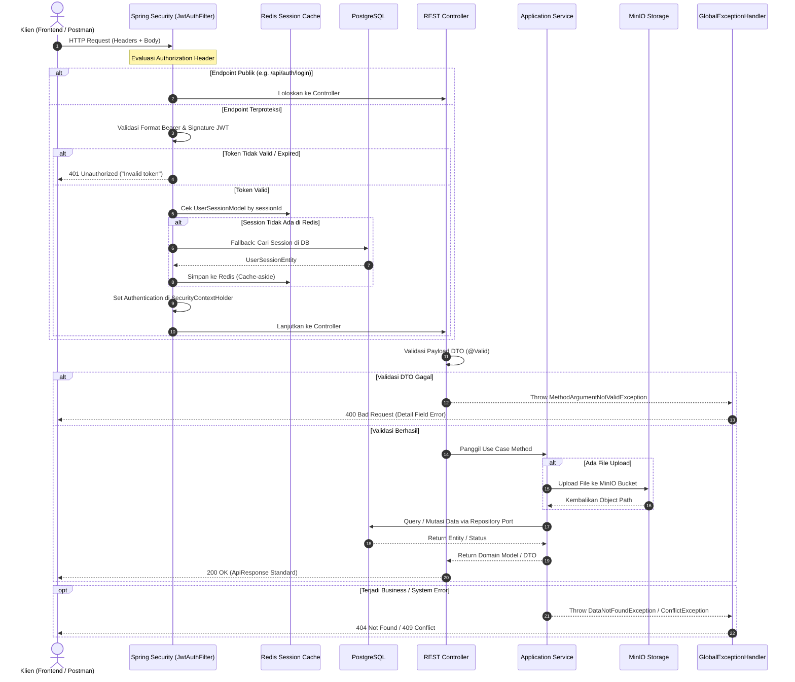

# 02. Arsitektur & System Flow

Dokumen ini menguraikan pola arsitektur perangkat lunak, batas-batas lapisan (*layer boundaries*), siklus hidup pemrosesan request (*request lifecycle*), serta interaksi antar-komponen pada sistem **BE Nuy Laundry**.

---

## 1. Pola Arsitektur: Hexagonal Architecture (Ports & Adapters)

Aplikasi mengadopsi prinsip **Hexagonal Architecture** (dikenal juga sebagai *Ports and Adapters* atau variasi *Clean Architecture*). Pola ini memisahkan inti logika bisnis dari kerangka kerja (*framework*), mekanisme penyimpanan data (*persistence*), protokol komunikasi, dan pustaka eksternal.

```mermaid
graph TD
    subgraph Driving Side [Primary / Driving Side]
        Client[Frontend Web / Mobile / API Client]
        HTTP[HTTP REST API / Multipart]
    end

    subgraph Presentation Layer [Presentation Layer]
        Controllers[REST Controllers<br/>AuthController, TransactionController, etc.]
        DTOs[Request & Response DTOs]
        Advices[GlobalExceptionHandler]
        Security[JwtAuthFilter]
    end

    subgraph Application Core [Application Core]
        subgraph Inbound Ports [Inbound Ports - Use Cases]
            AuthUC[AuthUseCase]
            UserUC[UserUseCase]
            CustUC[CustomerUseCase]
            PkgUC[PackageUseCase]
            TrxUC[TransactionUseCase]
            FileUC[FileUseCase]
        end
        
        subgraph Services [Application Services]
            AuthSvc[AuthServiceImpl]
            UserSvc[UserServiceImpl]
            CustSvc[CustomerServiceImpl]
            PkgSvc[PackageServiceImpl]
            TrxSvc[TransactionServiceImpl]
            FileSvc[FileServiceImpl]
        end

        subgraph Outbound Ports [Outbound Ports - Interfaces]
            RepoPort[Repository Ports<br/>TransactionRepositoryPort, etc.]
            StoragePort[FileStoragePort]
            CachePort[CachePort]
        end

        subgraph Domain Models [Domain Layer]
            Models[UserModel, CustomerModel, TransactionModel, PackageModel]
            Enums[UserRole, TransactionStatus, PackageType]
            DomainUtils[TransactionNumberGenerator]
        end
    end

    subgraph Infrastructure Layer [Infrastructure Layer - Driven Adapters]
        JPAAdapters[Repository Adapters<br/>TransactionRepositoryAdapter, etc.]
        MinioAdapter[MinioAdapter]
        RedisCache[RedisCacheService & SessionCacheService]
        JPARepos[Spring Data JPA Repositories]
        JPAEntities[JPA Entities]
    end

    subgraph External Systems [External Systems]
        PostgresDB[(PostgreSQL 16)]
        MinioStorage[(MinIO S3 Storage)]
        RedisServer[(Redis 7 Cache)]
    end

    %% Flow connections
    Client --> HTTP --> Security --> Controllers
    Controllers --> Inbound Ports
    Inbound Ports -.-> Services
    Services --> Domain Models
    Services --> Outbound Ports
    Outbound Ports -.-> JPAAdapters
    Outbound Ports -.-> MinioAdapter
    Outbound Ports -.-> RedisCache
    JPAAdapters --> JPARepos --> PostgresDB
    MinioAdapter --> MinioStorage
    RedisCache --> RedisServer
```

### Tanggung Jawab Masing-Masing Lapisan

1. **Domain Layer (`com.be_nuy_laundry.be_nuy_laundry.domain`)**:
   - Berisi entitas domain murni (`UserModel`, `TransactionModel`, dll) yang mewakili entitas bisnis di dunia nyata.
   - Bersifat agnostik terhadap basis data dan anotasi persistensi (tidak menggunakan anotasi `@Entity` JPA).
   - Menyimpan logika pembentukan nomor invoice (`TransactionNumberGenerator`).

2. **Application Layer (`com.be_nuy_laundry.be_nuy_laundry.application`)**:
   - **Inbound Ports (`ports.in`)**: Kontrak antarmuka (*interface*) use case bisnis yang dapat dipanggil dari luar (misal oleh controller).
   - **Outbound Ports (`ports.out`)**: Kontrak antarmuka yang dibutuhkan oleh service ke infrastruktur (misal persistensi data, penyimpanan berkas, atau cache).
   - **Services (`services`)**: Implementasi logika bisnis, koordinasi transaksi (`@Transactional`), kalkulasi harga, pemetaan model, dan validasi aturan bisnis.

3. **Presentation Layer (`com.be_nuy_laundry.be_nuy_laundry.presentation`)**:
   - Bertindak sebagai *driving adapter*.
   - Menerima HTTP request, melakukan validasi payload DTO (`@Valid`, `@ValidImage`), dan mengonversi hasil proses use case ke dalam format respon standar `ApiResponse<T>`.
   - Mengelola penanganan eksepsi terpusat melalui `GlobalExceptionHandler`.

4. **Infrastructure Layer (`com.be_nuy_laundry.be_nuy_laundry.infrastructure`)**:
   - Bertindak sebagai *driven adapter*.
   - Berisi implementasi konkret dari outbound ports:
     - `database.adapter`: Mengadaptasi operasi repository port ke Spring Data JPA.
     - `database.entity`: Entitas JPA yang merepresentasikan tabel PostgreSQL fisik.
     - `database.mapper`: Mengubah dua arah (*two-way mapping*) antara JPA Entity dan Domain Model.
     - `internal.cache`: Implementasi penyimpanan session di Redis.
     - `external.minio`: Implementasi upload, download, dan hapus berkas via MinIO S3 API.
     - `internal.security`: Konfigurasi Spring Security, implementasi JWT (`JwtServiceImpl`), dan filter keamanan HTTP (`JwtAuthFilter`).

---

## 2. Alur Request End-to-End (Request Lifecycle)

Setiap request HTTP yang masuk ke backend melewati tahapan berurutan sebagai berikut:



---

## 3. Komunikasi Sinkron vs Asinkron

1. **Komunikasi Sinkron (Synchronous)**:
   - Seluruh interaksi REST API antara klien dan backend berlangsung secara sinkron berbasis HTTP/1.1 (JSON dan `multipart/form-data`).
   - Interaksi dengan PostgreSQL (via JDBC/HikariCP), Redis (via Jedis/Lettuce), dan MinIO (via HTTP REST S3 SDK) dieksekusi secara sinkron (*blocking I/O*) di dalam thread request Tomcat.

2. **Status Komunikasi Asinkron (Asynchronous)**:
   - **Aktual**: Tidak ada proses asinkron aktif pada alur bisnis saat ini. Tidak ada *message publishing* ke antrian RabbitMQ yang aktif di lapisan kode sumber.
   - **Rencana Arsitektur**: RabbitMQ disiapkan di `docker-compose.yaml` dan `application.properties` untuk kebutuhan masa depan (misal: pengiriman notifikasi WhatsApp/Email saat cucian selesai atau pemrosesan background image compression).

---

## 4. Mekanisme Keamanan, Logging, & Error Handling

### A. Autentikasi & Otorisasi
- **Autentikasi**: Berbasis token JWT stateless yang diverifikasi silang dengan sesi di Redis cache (`UserSessionModel`). Jika sesi dicabut (*revoked* / `isActive = false`), token langsung tidak berlaku meskipun masa berlakunya belum habis.
- **Otorisasi**: Memanfaatkan Role-Based Access Control (`UserRole`: `SUPER_ADMIN`, `ADMIN`, `STAFF`). Endpoint sensitif paket (`PackageController`) dilindungi oleh `@PreAuthorize("hasAnyRole('ADMIN','SUPER_ADMIN')")`.

### B. Standardisasi Response
Seluruh endpoint konsisten mengembalikan struktur pembungkus `ApiResponse<T>`:
```json
{
  "code": 200,
  "status": "OK",
  "message": "SUCCESS",
  "data": { ... }
}
```
Untuk endpoint dengan paginasi, data dibungkus dalam `PageResponse<T>` yang berisi `content`, `page`, `size`, `totalElements`, dan `totalPages`.

### C. Error Handling Terpusat
Kelas [GlobalExceptionHandler](../src/main/java/com/be_nuy_laundry/be_nuy_laundry/presentation/advices/GlobalExceptionHandler.java) menangani:
- `DataNotFoundException` -> HTTP 404
- `ConflictException` -> HTTP 409
- `UnauthorizedException` -> HTTP 401
- `MethodArgumentNotValidException` & `ConstraintViolationException` -> HTTP 400 (dengan daftar detail pesan kesalahan per field)
- `MaxUploadSizeExceededException` -> HTTP 400
- `Exception` (General) -> HTTP 500
