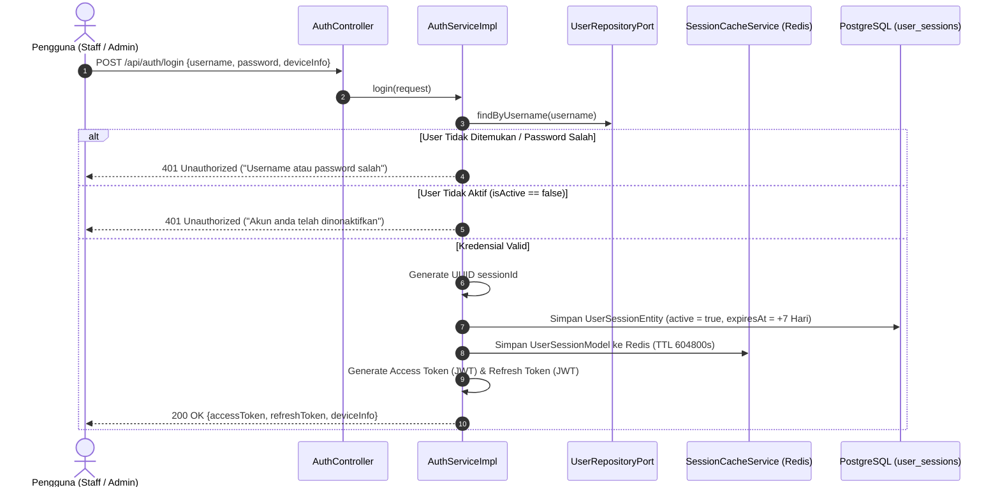
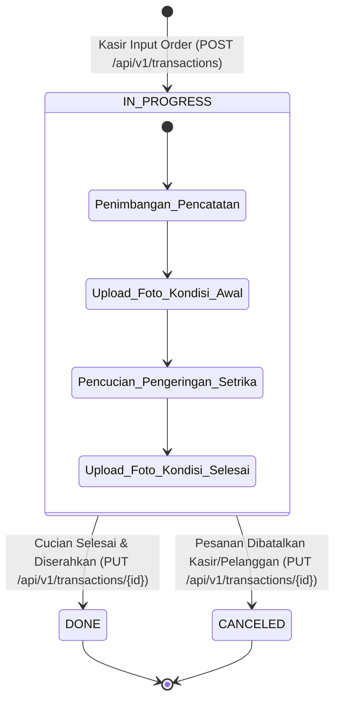
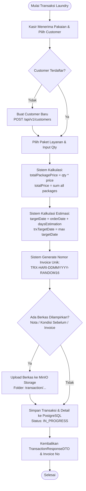

# 03. Alur Bisnis (Business Flow)

Dokumen ini menjelaskan alur operasional bisnis binatu (*laundry*), peran pengguna (*user roles*), hierarki otorisasi, serta siklus hidup pemrosesan pesanan dari awal hingga selesai pada sistem **BE Nuy Laundry**.

---

## 1. Peran Pengguna (User Roles) & Matriks Hak Akses

Sistem mendefinisikan tiga peran pengguna melalui enum [UserRole](../src/main/java/com/be_nuy_laundry/be_nuy_laundry/infrastructure/internal/database/entity/enumrated/UserRole.java):

| Fitur / Modul | SUPER_ADMIN | ADMIN | STAFF (Karyawan/Kasir) |
| :--- | :---: | :---: | :---: |
| **Login & Refresh Token** | ✅ | ✅ | ✅ |
| **Pencatatan Pelanggan Baru (Customer CRUD)** | ✅ | ✅ | ✅ |
| **Pencarian & Riwayat Pelanggan** | ✅ | ✅ | ✅ |
| **Pembuatan Transaksi Order Baru** | ✅ | ✅ | ✅ |
| **Update Transaksi & Status Cucian** | ✅ | ✅ | ✅ |
| **Upload Dokumentasi Berkas Transaksi** | ✅ | ✅ | ✅ |
| **Hapus Transaksi & Berkas Transaksi** | ✅ | ✅ | ✅ |
| **Hapus Item Detail Transaksi (Min. 1 Item)**| ✅ | ✅ | ✅ |
| **Manajemen Paket Layanan (Create/Update/Delete Package)** | ✅ | ✅ | ❌ (*403 Forbidden*) |
| **Melihat Daftar Paket Layanan (Read Package)** | ✅ | ✅ | ✅ |
| **Manajemen Benefit Layanan (Benefit CRUD)** | ✅ | ✅ | ✅ |
| **Manajemen Pengguna (User CRUD & Reset Password)** | ✅ | ✅ | ⚠️ *(Lihat Temuan Teknis)* |

> [!WARNING]
> **Catatan Otorisasi Endpoint User**:
> Sesuai konfigurasi aktual di [SecurityConfig.java](../src/main/java/com/be_nuy_laundry/be_nuy_laundry/infrastructure/internal/security/SecurityConfig.java#L30), path `/api/v1/users/**` saat ini terekspos publik (`permitAll()`). Pembatasan role hanya diterapkan secara deklaratif pada `PackageController` menggunakan `@PreAuthorize("hasAnyRole('ADMIN','SUPER_ADMIN')")`.

---

## 2. Alur Autentikasi & Manajemen Sesi



---

## 3. Siklus Hidup Transaksi Order (Order Lifecycle)

Transaksi order mencatat pesanan laundry dari pelanggan dan diproses dengan tahapan berikut:



---

## 4. Alur Bisnis Pembuatan Transaksi Baru (Create Transaction)



### Logika Bisnis Penting pada Transaksi:
1. **Nomor Invoice Otomatis**:
   - Dibuat menggunakan kelas [TransactionNumberGenerator](../src/main/java/com/be_nuy_laundry/be_nuy_laundry/domain/utils/TransactionNumberGenerator.java).
   - Format: `TRX-[HARI_ID]-[TANGGAL]-[ALPHANUMERIC_16]`. Contoh: `TRX-SEN-23102026-A1B2C3D4E5F6G7H8`.
2. **Kalkulasi Estimasi Tanggal Selesai (`targetDate`)**:
   - Masing-masing detail memiliki estimasi: `orderDate + package.daysEstimation`.
   - Estimasi keseluruhan transaksi diambil dari nilai maksimum (`maxEstimationDate`) dari seluruh paket yang diambil di dalam pesanan tersebut, atau ditentukan manual oleh kasir.
3. **Integritas Detail Transaksi**:
   - Transaksi tidak boleh kosong. Pada [TransactionDetailServiceImpl.java](../src/main/java/com/be_nuy_laundry/be_nuy_laundry/application/services/TransactionDetailServiceImpl.java#L54), penghapusan item detail pesanan memiliki proteksi:
     ```java
     if (existingTransactionModel.getTransactionDetails().size() <= 1)
         throw new ConflictException("Minimal harus ada 1 transaksi detail");
     ```
   - Total tagihan transaksi otomatis disesuaikan secara real-time saat salah satu item detail dihapus: `totalPrice = totalPrice - deletedDetail.totalPrice`.
4. **Pembersihan Berkas Otomatis saat Transaksi Dihapus**:
   - Pada [TransactionServiceImpl.java](../src/main/java/com/be_nuy_laundry/be_nuy_laundry/application/services/TransactionServiceImpl.java#L175-L186), jika transaksi dihapus, sistem secara otomatis melacak seluruh berkas MinIO yang terasosiasi dan menghapusnya dari MinIO Storage sebelum menghapus rekaman di database PostgreSQL.
