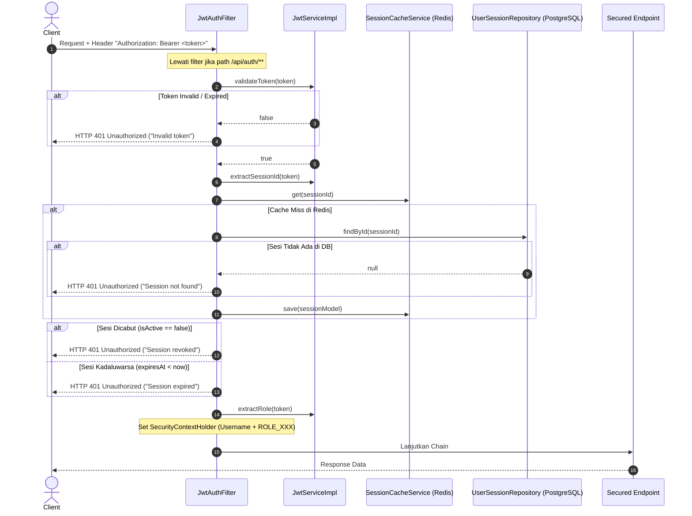

# 09 - Security & Operational Behavior

Dokumen ini menjelaskan mekanisme keamanan sistem, autentikasi dan otorisasi, penanganan rahasia/kredensial, manajemen transaksi database, serta karakteristik operasional aktual pada backend **Nuy Laundry**.

---

## 1. Mekanisme Autentikasi (Authentication)

Aplikasi mengimplementasikan mekanisme autentikasi berbasis **JSON Web Token (JWT)** yang dikombinasikan dengan validasi sesi terdistribusi menggunakan **Redis** dan persistensi database PostgreSQL:

### Karakteristik Token JWT
- **Algoritma**: HMAC-SHA256 (`HS256`) menggunakan kunci rahasia simetris 256-bit.
- **Klaim Token (Claims)**:
  - `sub`: Username pengguna.
  - `userId`: UUID pengguna.
  - `role`: Role pengguna (`SUPER_ADMIN`, `ADMIN`, `STAFF`).
  - `sessionId`: UUID record tabel `user_sessions`.
  - `iat`: Timestamp penerbitan token.
  - `exp`: Timestamp kedaluwarsa.
- **Masa Berlaku Default**:
  - Access Token: `900000000 ms` (~10.4 hari).
  - Refresh Token: `604800000000 ms` (~7000 hari).
  - Redis Sesi TTL: `604800 detik` (7 hari).

---

## 2. Mekanisme Otorisasi (Authorization)

Otorisasi dieksekusi melalui dua lapis:

1. **SecurityFilterChain (`SecurityConfig.java`)**:
   - `/api/auth/**` -> Diizinkan tanpa autentikasi (`permitAll()`).
   - `/api/v1/users/**` -> Diizinkan tanpa autentikasi (`permitAll()`) *(Catatan temuan: konfigurasi ini mengekspos endpoint user secara publik)*.
   - `anyRequest().authenticated()` -> Mengharuskan header `Authorization: Bearer <valid_token>`.

2. **Method-Level Security (`@PreAuthorize`)**:
   - Diaktifkan melalui `@EnableMethodSecurity`.
   - Digunakan secara selektif pada `PackageController`:
     - `POST /api/v1/packages`: `@PreAuthorize("hasAnyRole('ADMIN','SUPER_ADMIN')")`
     - `PUT /api/v1/packages/{id}`: `@PreAuthorize("hasAnyRole('ADMIN','SUPER_ADMIN')")`
     - `DELETE /api/v1/packages/{id}`: `@PreAuthorize("hasAnyRole('ADMIN','SUPER_ADMIN')")`
   - Role diterjemahkan dengan prefix standar Spring Security: `ROLE_SUPER_ADMIN`, `ROLE_ADMIN`, `ROLE_STAFF`.

---

## 3. Pengelolaan Secret & Environment Variables

- Seluruh nilai kredensial sensitif diabstraksikan ke dalam konfigurasi `application.properties` dengan sintaks substitusi environment variable `${VAR_NAME:default_value}`.
- Pada lingkungan produksi, variabel berikut **wajib di-inject** dari secret manager (Kubernetes Secrets, AWS Secrets Manager, atau Docker Secrets) dan tidak boleh mengandalkan nilai default:
  - `JWT_SECRET`: Kunci HMAC-SHA256 minimal 256-bit (32 karakter/64 hex characters).
  - `DB_USER` dan `DB_PASSWORD`: Kredensial PostgreSQL.
  - `MINIO_USERNAME` dan `MINIO_PASSWORD`: Kredensial S3 Object Storage.

---

## 4. Perlindungan Data Sensitif (Sensitive Data Masking)

1. **Password Hashing**:
   - Password disimpan menggunakan algoritma **BCrypt** dengan salted hash satu arah via bean `BCryptPasswordEncoder()`.
   - Password plaintext tidak pernah disimpan di database atau ditulis ke file log.

2. **Response DTO Projection**:
   - Domain Model `UserModel` yang memuat field `password` tidak pernah dikembalikan langsung ke presentation layer.
   - Endpoint mengembalikan `UserResponseDTO` yang secara eksplisit tidak menyertakan field `password`.

---

## 5. Manajemen Transaksi (Transaction Management)

- Menggunakan Spring Declarative Transaction Management (`@Transactional`).
- **Cakupan**:
  - Diterapkan pada level Application Service (`CustomerServiceImpl`, `TransactionServiceImpl`, `TransactionFileServiceImpl`, `BenefitServiceImpl`, `PackageServiceImpl`, `AuthServiceImpl`).
  - Menjamin prinsip **Atomicity** dan **Consistency** ketika membuat transaksi laundry induk berserta baris detail transaksi dan record file attachment.
  - Jika terjadi runtime exception saat upload metadata file atau kalkulasi harga, transaksi database di-rollback secara otomatis.

---

## 6. Logging & Audit Trail

- **Logging**:
  - Framework: SLF4J dengan implementasi Logback bawaan Spring Boot.
  - Error pada autentikasi JWT dicatat dengan level `ERROR`: `log.error("JWT validation failed: {}", e.getMessage())`.
- **Audit Trail Kolom**:
  - Entitas JPA mewarisi `BaseEntity` yang dilengkapi anotasi Hibernate `@CreationTimestamp` (`createdAt`) dan `@UpdateTimestamp` (`updatedAt`).
  - *Catatan Faktual*: Belum terdapat pencatatan audit log aktor pengubah (`createdBy`, `updatedBy`) secara otomatis via `AuditorAware`, serta belum tersedia implementasi Correlation ID / MDC logging untuk tracing per request HTTP.

---

## 7. Analisis Perilaku Operasional: Asynchronous, Concurrency, & Idempotency

| Aspek Operasional | Status Implementasi Aktual | Analisis & Dampak |
| :--- | :--- | :--- |
| **Concurrency Control** | Pendelegasian ke Database MVCC | Tidak menggunakan optimistic locking (`@Version`) atau pessimistic locking. Operasi update status bergantung pada serialisasi database PostgreSQL. |
| **Idempotency** | Sebagian (Parsial) | Endpoint `POST /api/v1/transactions` tidak memiliki idempotency-key header. Pengiriman duplikat request akan membuat invoice baru yang berbeda. Namun nomor invoice dijamin unik melalui sequence database. |
| **Asynchronous Processing (`@Async`)** | **Tidak Diterapkan** | Semua operasi (termasuk upload file multi-part fisik ke MinIO S3) dieksekusi secara synchronous blocking pada thread HTTP worker (Tomcat thread). |
| **Scheduler (`@Scheduled`)** | **Tidak Diterapkan** | Tidak ada background scheduler untuk pembersihan file yatim (*orphan files*) atau sesi kedaluwarsa di PostgreSQL. |
| **Retry Mechanism** | **Tidak Diterapkan** | Kegagalan koneksi jaringan ke MinIO atau Redis akan langsung melempar exception ke client tanpa percobaan otomatis (*auto-retry*). |
