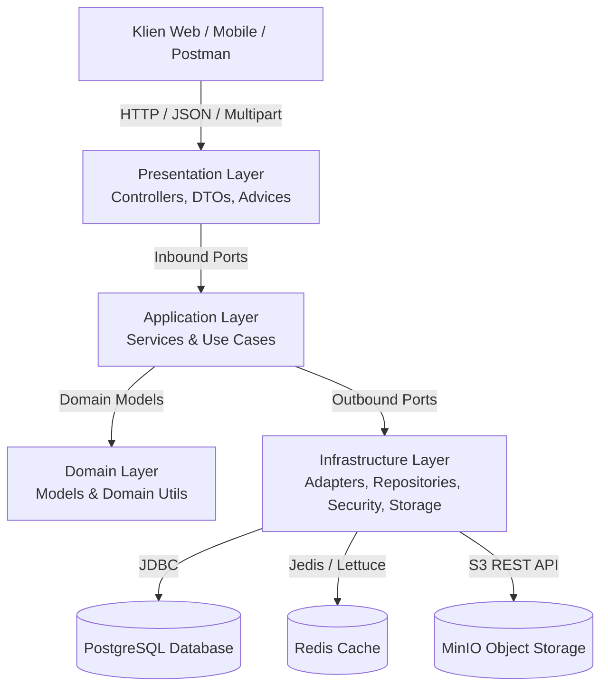

# Dokumentasi Teknis Sistem BE Nuy Laundry

Selamat datang di repositori dokumentasi teknis resmi untuk **BE Nuy Laundry** (Backend Nuy Laundry System). Dokumentasi ini disusun secara komprehensif berdasarkan kode sumber aktual dan konfigurasi yang terverifikasi pada repositori, dengan tujuan memberikan pemahaman arsitektur, domain bisnis, struktur kode, skema database, integrasi sistem, dan panduan operasional bagi pengembang (baik junior developer maupun AI agent).

---

## 📚 Daftar Isi Dokumentasi (Documentation Index)

Dokumentasi ini dibagi menjadi 11 dokumen tematik independen yang saling terhubung:

| No | Dokumen | Deskripsi Ringkas |
| :---: | :--- | :--- |
| **01** | [01. Project Overview & Tech Stack](./system-specs/01-project-overview.md) | Visi sistem, domain bisnis laundry kiloan/satuan, detail runtime Java 17, Spring Boot 3.2.5, dependensi Maven, dan integrasi infrastruktur eksternal. |
| **02** | [02. Arsitektur & System Flow](./system-specs/02-architecture.md) | Pola Arsitektur Hexagonal (Ports & Adapters) / Clean Architecture, layer boundaries, diagram C4/arsitektur, alur request end-to-end, dan sinkronisasi data. |
| **03** | [03. Alur Bisnis (Business Flow)](./system-specs/03-business-flow.md) | Peran pengguna (`SUPER_ADMIN`, `ADMIN`, `STAFF`), alur autentikasi session, manajemen master data, workflow order laundry, status transaksi, kalkulasi estimasi & harga. |
| **04** | [04. Manajemen Berkas (File Management)](./system-specs/04-file-management.md) | Arsitektur integrasi MinIO Object Storage, klasifikasi berkas transaksi (nota pembayaran, kondisi cucian, invoice), validasi berkas, serta siklus upload & delete. |
| **05** | [05. Basis Data & Kamus Data](./system-specs/05-database.md) | Migrasi Liquibase, Entity-Relationship Diagram (ERD), relasi foreign key, kamus data tabel (Users, Customers, Packages, Benefits, Transactions, dll). |
| **06** | [06. Struktur Direktori & Modul](./system-specs/06-codebase-structure.md) | Pemetaan struktur folder (Application, Domain, Infrastructure, Presentation, Common), tanggung jawab layer, konvensi kode, mapper, dan utility classes. |
| **07** | [07. Inventaris API & Integrasi](./system-specs/07-api-integration.md) | Katalog lengkap REST API endpoints, HTTP method, payload request DTO, response DTO, HTTP status, validasi input, dan contoh payload JSON. |
| **08** | [08. Setup, Build & Deployment](./system-specs/08-setup-build-deployment.md) | Prasyarat lingkungan, instruksi menjalankan Docker Compose (PostgreSQL, Redis, RabbitMQ, MinIO), kompilasi Maven Wrapper, profil konfigurasi, dan Dockerfile. |
| **09** | [09. Keamanan & Perilaku Operasional](./system-specs/09-security-operations.md) | Mekanisme Spring Security, filter autentikasi JWT (`JwtAuthFilter`), session caching di Redis, hashing BCrypt, pengelolaan konfigurasi sensitif, dan penanganan transaksi database. |
| **10** | [10. Panduan Testing & Troubleshooting](./system-specs/10-testing-troubleshooting.md) | Struktur unit test JUnit 5 & Mockito, konfigurasi JaCoCo coverage (99.98% coverage), panduan verifikasi, daftar potensi error operasional beserta solusinya. |
| **11** | [11. Temuan Teknis & Rekomendasi](./system-specs/11-technical-findings.md) | Hasil audit kode teknis: analisis bug kritis (inversi validasi invoice file), inkonsistensi path variable, celah keamanan endpoint terbuka, dead configuration, dan mitigasi prioritas. |

---

## 🎯 Tiket Pengembangan & Panduan Pengujian (Task & Issue Guides)

Kumpulan tiket tugas terstruktur berspesifikasi *high-level* untuk memandu junior developer atau AI agent dalam implementasi dan pengujian sistem:

| Dokumen Tiket | Fokus Tugas | Status |
| :--- | :--- | :---: |
| [API Testing Issues](./issues/02-API_TESTING_ISSUES.md) | Tiket uji fungsional & negatif E2E (TEST-01 s/d TEST-06) dengan runner otomatis [scripts/test_runner.py](../scripts/test_runner.py). | ✅ 100% Pass (46/46) |
| [Unit Testing Issues](./issues/01-UNIT_TEST_ISSUES.md) | Tiket pembuatan unit test JUnit 5 & Mockito (UT-01 s/d UT-15) dengan target 100% coverage. | ✅ 100% Completed |
| [Performance Evaluation Issues](./issues/03-PERFORMANCE_EVALUATION_ISSUES.md) | Tiket evaluasi performa server, JVM, PostgreSQL N+1/indexing, Redis caching, MinIO throughput, & load testing (PERF-00 s/d PERF-11). | 📋 Ready for Execution |
| [Project Plan & Service Ports](./PROJECT_PLAN.md) | Prioritas fitur roadmap, status modul, dan port lokal infrastruktur pendukung. | 📌 Active Reference |

## 🚀 Panduan Ringkas Memulai (Quick Start)

### 1. Menjalankan Layanan Infrastruktur Pendukung
Aplikasi bergantung pada 4 layanan pendukung (PostgreSQL, Redis, RabbitMQ, dan MinIO) yang dikelola melalui Docker Compose:
```bash
docker compose up -d
```
Pastikan seluruh container telah sehat (*healthy*) dengan mengecek `docker compose ps`.

### 2. Menjalankan Aplikasi Backend
Pastikan JDK 17 telah terpasang:
```bash
./mvnw spring-boot:run
```
Aplikasi backend akan berjalan pada port default: `http://localhost:8080`.

### 3. Menjalankan Suite Unit Test & Laporan Coverage
Untuk mengeksekusi seluruh 220 unit test dengan verifikasi laporan JaCoCo:
```bash
./mvnw clean test jacoco:report
```
Laporan visual coverage dapat dilihat pada peramban web: `target/site/jacoco/index.html`.

---

## 🏛️ Arsitektur Inti Sekilas (High-Level Overview)

Aplikasi dibangun menggunakan prinsip **Hexagonal Architecture (Ports and Adapters)**:
- **Presentation Layer**: Menangani HTTP request, validasi DTO, dan response wrapping (`ApiResponse<T>`).
- **Application Layer**: Menyediakan use cases (inbound ports) dan mendefinisikan interface output (outbound ports).
- **Domain Layer**: Mengisolasi model bisnis murni (`UserModel`, `CustomerModel`, `TransactionModel`, dll) tanpa anotasi JPA/framework.
- **Infrastructure Layer**: Mengimplementasikan adapter untuk database (Spring Data JPA, PostgreSQL, Liquibase), cache (Redis), berkas (MinIO), dan keamanan (Spring Security, JJWT).



---

## 📌 Standar Etika & Keamanan Kode
1. **Tidak Ada Kredensial Nyata**: Dokumentasi ini tidak mengekspos kredensial produksi, password aktual, secret key aktif, maupun data pelanggan.
2. **Kesesuaian Implementasi Aktual**: Informasi dalam dokumentasi ini mencerminkan apa yang *saat ini terimplementasi di source code*, termasuk mencatat bagian-bagian yang merupakan *technical debt* atau belum terhubung (seperti RabbitMQ).
