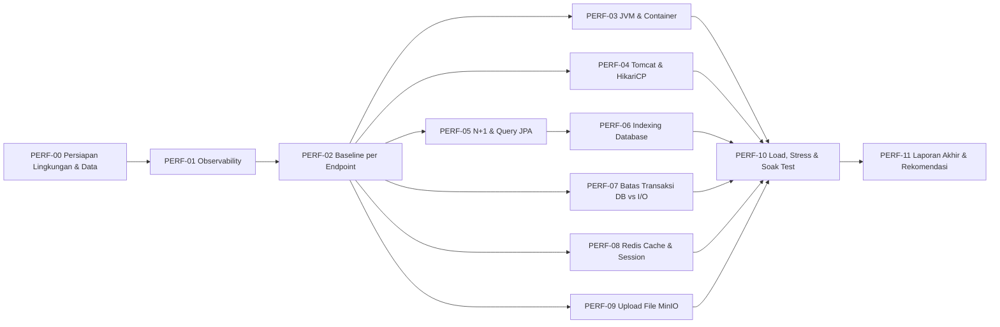

# Roadmap & Issue Breakdown: Evaluasi Performa Server, Database, & Aplikasi

Dokumen ini berisi tiket kerja untuk **mengukur, menganalisis, dan memperbaiki performa** BE Nuy Laundry secara menyeluruh: server (JVM, Tomcat, container), database (PostgreSQL, JPA/Hibernate), cache (Redis), file storage (MinIO), dan aplikasi secara end-to-end.

Bahasa sengaja dibuat **high-level dan langkah demi langkah** agar bisa dikerjakan oleh *junior developer* atau *AI agent* yang lebih murah tanpa harus memahami seluruh sistem terlebih dahulu.

---

## 📖 Cara Menggunakan Dokumen Ini

1. Baca bagian **Aturan Main** dan **Glosarium** terlebih dahulu (5 menit).
2. Kerjakan tiket **sesuai urutan** pada diagram di bawah. Tiket awal adalah fondasi pengukuran untuk tiket berikutnya.
3. Setiap tiket memiliki: **Latar Belakang → Lokasi Kode → Langkah Kerja → Kriteria Lolos → Output yang Diserahkan**.
4. Hasil setiap tiket dicatat ke file laporan `docs/reports/PERFORMANCE_REPORT.md` (buat jika belum ada) menggunakan template di bagian akhir dokumen.



---

## ⚖️ Aturan Main (Wajib Dipatuhi)

1. **Ukur dulu, baru ubah.** Dilarang mengoptimasi tanpa angka *sebelum* dan *sesudah*. Setiap perubahan wajib punya bukti metrik.
2. **Satu perubahan per eksperimen.** Jangan mengubah pool size, index, dan cache sekaligus. Ubah satu, ukur, catat, baru lanjut.
3. **Lingkungan pengujian harus sama** setiap kali mengukur (mesin, jumlah data, konfigurasi Docker, aplikasi lain dimatikan).
4. **Jangan merusak fungsionalitas.** Setelah setiap perubahan kode, jalankan:
   - `./mvnw test` → seluruh unit test wajib lulus (baseline: 230 test).
   - `python3 scripts/test_runner.py` → seluruh API test wajib lulus (baseline: 46/46).
5. **Jangan mengukur dengan log SQL aktif.** Log SQL (`show-sql`) sangat memperlambat aplikasi dan membuat angka tidak valid (lihat PERF-00).
6. **Jangan commit kredensial** atau data pelanggan asli ke repository.
7. Jika menemukan masalah di luar lingkup tiket, **catat saja** di laporan bagian "Temuan Tambahan", jangan langsung diperbaiki.

---

## 📚 Glosarium Singkat

| Istilah | Arti Sederhana |
| :--- | :--- |
| **Latency / Response Time** | Waktu dari request dikirim sampai response diterima. |
| **p50 / p95 / p99** | 50% / 95% / 99% request selesai di bawah angka ini. p95 lebih jujur daripada rata-rata. |
| **RPS (Throughput)** | Jumlah request yang mampu dilayani per detik. |
| **VU (Virtual User)** | Pengguna simulasi pada tool load test (k6). |
| **Error Rate** | Persentase request yang gagal (HTTP 5xx, timeout). |
| **N+1 Query** | 1 query untuk mengambil daftar, lalu N query tambahan untuk setiap baris. Penyebab lambat paling umum di JPA. |
| **Connection Pool (HikariCP)** | Kumpulan koneksi database yang dipakai bergantian. Jika habis, request harus menunggu. |
| **GC Pause** | Jeda saat JVM membersihkan memori. Jeda panjang = request ikut tertahan. |
| **Cache Hit Ratio** | Persentase data yang berhasil diambil dari cache tanpa ke database. |
| **Soak Test** | Load test durasi panjang untuk mendeteksi memory leak. |

---

## 🎯 Target Performa (SLO) yang Dijadikan Acuan

> Angka ini adalah target awal untuk lingkungan lokal/Docker. Jika target tidak realistis setelah baseline, tuliskan alasan dan usulan target baru di laporan.

| Kategori Endpoint | Contoh | p95 | p99 | Error Rate |
| :--- | :--- | :---: | :---: | :---: |
| Read sederhana | `GET /api/v1/packages`, `GET /api/v1/customers/{id}` | < 150 ms | < 400 ms | < 0.5% |
| Read kompleks (list + relasi) | `GET /api/v1/transactions?page=0&size=20` | < 300 ms | < 800 ms | < 0.5% |
| Write tanpa file | `POST /api/v1/customers`, `PUT /api/v1/transactions/{id}` | < 400 ms | < 1000 ms | < 1% |
| Write dengan file | `POST /api/v1/transactions` (multipart), `POST /api/v1/transaction-files` | < 1000 ms | < 2000 ms | < 1% |
| Autentikasi | `POST /api/auth/login`, `GET /api/auth/me` | < 300 ms | < 700 ms | < 0.5% |

**Target sistem:** stabil pada **≥ 100 RPS** campuran, tanpa `OutOfMemoryError`, tanpa HikariCP timeout.

---

## 🔍 Temuan Awal dari Audit Kode (Titik yang Wajib Dicek)

Daftar ini adalah **petunjuk awal** hasil pembacaan kode. Pelaksana wajib **membuktikan** dengan pengukuran sebelum memperbaiki.

| # | Temuan | Lokasi | Tiket Terkait |
| :---: | :--- | :--- | :---: |
| 1 | Log SQL aktif penuh (`show-sql`, `format_sql`, `highlight_sql`) dan log Liquibase level `DEBUG`. | [application.properties](../../src/main/resources/application.properties) | PERF-00 |
| 2 | Tidak ada Spring Boot Actuator, sehingga tidak ada metrik JVM/HTTP/HikariCP. | [pom.xml](../../pom.xml) | PERF-01 |
| 3 | Dockerfile menjalankan `java -jar app.jar` tanpa pengaturan heap/GC. | [Dockerfile](../../Dockerfile) | PERF-03 |
| 4 | HikariCP dan Tomcat memakai nilai default (tidak dikonfigurasi). | [application.properties](../../src/main/resources/application.properties) | PERF-04 |
| 5 | `TransactionMapper.mapToDomain` mengakses koleksi `transactionDetails` dan `transactionFileEntities` (LAZY) untuk setiap transaksi → potensi **N+1** pada list transaksi. | [TransactionMapper.java](../../src/main/java/com/be_nuy_laundry/be_nuy_laundry/infrastructure/internal/database/mapper/TransactionMapper.java) | PERF-05 |
| 6 | Relasi `@ManyToOne` tanpa `fetch = LAZY` (default **EAGER**) di `TransactionEntity` (customer, user) dan `TransactionDetailEntity` (pkg, transaction). | [TransactionEntity.java](../../src/main/java/com/be_nuy_laundry/be_nuy_laundry/infrastructure/internal/database/entity/TransactionEntity.java), [TransactionDetailEntity.java](../../src/main/java/com/be_nuy_laundry/be_nuy_laundry/infrastructure/internal/database/entity/TransactionDetailEntity.java) | PERF-05 |
| 7 | `CustomerJpaRepository` memakai `@EntityGraph` yang ikut memuat **seluruh transaksi + detail** milik customer. Berat untuk customer lama. | [CustomerJpaRepository.java](../../src/main/java/com/be_nuy_laundry/be_nuy_laundry/infrastructure/internal/database/repository/CustomerJpaRepository.java) | PERF-05 |
| 8 | Changelog Liquibase hanya punya 1 index unik (`users.username`). Kolom foreign key **tidak di-index** (PostgreSQL tidak otomatis membuat index untuk FK). `transactions.invoice_no` tidak unik/ter-index. | [db/changelog/](../../src/main/resources/db/changelog/) | PERF-06 |
| 9 | Upload file ke MinIO dilakukan **di dalam** method `@Transactional` saat membuat transaksi → koneksi database tertahan selama proses upload. | [TransactionServiceImpl.java](../../src/main/java/com/be_nuy_laundry/be_nuy_laundry/application/services/TransactionServiceImpl.java) | PERF-07 |
| 10 | Session sudah di-cache di Redis (cache-aside di `JwtAuthFilter`), tetapi master data (paket, benefit) belum di-cache sama sekali. | [JwtAuthFilter.java](../../src/main/java/com/be_nuy_laundry/be_nuy_laundry/infrastructure/internal/security/JwtAuthFilter.java) | PERF-08 |
| 11 | `MinioAdapter` mengunggah file dari `byte[]` (`new ByteArrayInputStream(file)`), artinya seluruh isi file dimuat ke heap. | [MinioAdapter.java](../../src/main/java/com/be_nuy_laundry/be_nuy_laundry/infrastructure/external/minio/MinioAdapter.java) | PERF-09 |
| 12 | `max-request-size=3MB` berlaku untuk **total** request, bukan per file. Upload banyak foto sekaligus bisa ditolak. | [application.properties](../../src/main/resources/application.properties) | PERF-09 |

---

## 🛠️ Daftar Tiket

| Kode | Judul | Estimasi | Prioritas |
| :--- | :--- | :---: | :---: |
| **PERF-00** | Persiapan Lingkungan Uji & Data Dummy | 0.5 hari | Wajib pertama |
| **PERF-01** | Observability: Actuator & Metrik | 0.5 hari | Tinggi |
| **PERF-02** | Pengukuran Baseline per Endpoint | 0.5 hari | Tinggi |
| **PERF-03** | Evaluasi JVM, Memori, GC & Container | 1 hari | Sedang |
| **PERF-04** | Evaluasi Tomcat Thread & HikariCP Pool | 0.5 hari | Tinggi |
| **PERF-05** | Audit N+1 Query & Strategi Fetch JPA | 1–2 hari | **Kritis** |
| **PERF-06** | Audit Index & Query Plan PostgreSQL | 1 hari | **Kritis** |
| **PERF-07** | Evaluasi Batas Transaksi DB vs I/O Eksternal | 1 hari | Tinggi |
| **PERF-08** | Evaluasi Redis: Session & Cache Master Data | 1 hari | Sedang |
| **PERF-09** | Evaluasi Upload File & MinIO | 1 hari | Sedang |
| **PERF-10** | Load, Stress, Spike & Soak Test (k6) | 1–2 hari | Tinggi |
| **PERF-11** | Laporan Akhir & Rekomendasi Tuning | 0.5 hari | Wajib terakhir |

---

### [PERF-00] Persiapan Lingkungan Uji & Data Dummy

**Latar Belakang**
Hasil pengukuran hanya bermakna jika lingkungannya konsisten dan datanya cukup banyak. Database kosong akan selalu terlihat cepat, padahal masalah N+1 dan index baru muncul saat data besar.

**Langkah Kerja**
1. **Buat profil khusus performa** `src/main/resources/application-perf.properties` yang menimpa konfigurasi logging:
   ```properties
   spring.jpa.show-sql=false
   spring.jpa.properties.hibernate.format_sql=false
   spring.jpa.properties.hibernate.highlight_sql=false
   logging.level.liquibase=INFO
   logging.level.org.springframework.boot.autoconfigure.liquibase=INFO
   # Aktifkan statistik Hibernate untuk menghitung jumlah query (dipakai di PERF-05)
   spring.jpa.properties.hibernate.generate_statistics=true
   logging.level.org.hibernate.stat=INFO
   ```
   Jalankan aplikasi dengan: `./mvnw spring-boot:run -Dspring-boot.run.profiles=perf`
2. **Buat skrip seed data** di `scripts/perf/seed_data.py` (Python, memakai API yang sudah ada atau SQL langsung). Volume minimal:

   | Entitas | Jumlah |
   | :--- | ---: |
   | Users | 50 |
   | Customers | 2.000 |
   | Benefits | 20 |
   | Packages | 30 (masing-masing 2–5 benefit) |
   | Transactions | 20.000 (masing-masing 1–4 detail) |
   | Transaction Files | 5.000 (metadata saja boleh, file kecil) |

3. **Catat spesifikasi lingkungan** di laporan: CPU, RAM, OS, versi Docker, versi Java, jumlah data hasil seed.
4. Pastikan semua container sehat: `docker compose ps` (postgres, redis, minio, rabbitmq berstatus *healthy*).

**Kriteria Lolos**
- Profil `perf` berjalan tanpa log SQL di console.
- Database berisi data sesuai tabel volume di atas (buktikan dengan `SELECT COUNT(*)` per tabel).
- Skrip seed bisa dijalankan ulang (idempotent atau ada opsi `--reset`).

**Output yang Diserahkan**
- `application-perf.properties`, `scripts/perf/seed_data.py`, bagian "Lingkungan Uji" di laporan.

---

### [PERF-01] Observability: Actuator & Metrik

**Latar Belakang**
Tanpa metrik, kita tidak bisa tahu apakah yang lambat itu CPU, memori, koneksi database, atau kode. Saat ini proyek belum memiliki Spring Boot Actuator.

**Langkah Kerja**
1. Tambahkan dependency di `pom.xml`:
   ```xml
   <dependency>
       <groupId>org.springframework.boot</groupId>
       <artifactId>spring-boot-starter-actuator</artifactId>
   </dependency>
   <dependency>
       <groupId>io.micrometer</groupId>
       <artifactId>micrometer-registry-prometheus</artifactId>
   </dependency>
   ```
2. Konfigurasi di `application.properties`:
   ```properties
   management.endpoints.web.exposure.include=health,info,metrics,prometheus
   management.endpoint.health.show-details=when_authorized
   management.metrics.distribution.percentiles-histogram.http.server.requests=true
   management.metrics.distribution.percentiles.http.server.requests=0.5,0.95,0.99
   ```
3. Atur akses di `SecurityConfig`: `/actuator/health` boleh publik, endpoint actuator lainnya **wajib login** (role `SUPER_ADMIN`) agar tidak bocor ke publik. Sesuaikan juga `JwtAuthFilter.shouldNotFilter` bila perlu.
4. Verifikasi metrik berikut bisa diakses:

   | Metrik | Kegunaan |
   | :--- | :--- |
   | `/actuator/health` | Status PostgreSQL, Redis, disk |
   | `/actuator/metrics/http.server.requests` | Latency & jumlah request per endpoint |
   | `/actuator/metrics/jvm.memory.used` | Pemakaian heap |
   | `/actuator/metrics/jvm.gc.pause` | Lama jeda GC |
   | `/actuator/metrics/hikaricp.connections.active` | Koneksi DB yang sedang dipakai |
   | `/actuator/metrics/hikaricp.connections.pending` | Request yang **menunggu** koneksi DB (harus ≈ 0) |
   | `/actuator/metrics/tomcat.threads.busy` | Thread Tomcat yang sibuk |

5. *(Opsional, direkomendasikan)* Tambahkan service `prometheus` dan `grafana` ke `docker-compose.yaml` dan import dashboard "JVM (Micrometer)" & "Spring Boot Statistics" agar grafik bisa dipantau selama load test.

**Kriteria Lolos**
- `/actuator/health` mengembalikan `"status": "UP"` beserta komponen `db` dan `redis`.
- `/actuator/prometheus` tidak bisa diakses tanpa token.
- Unit test & API test tetap lulus.

**Output yang Diserahkan**
- Perubahan `pom.xml`, `application.properties`, `SecurityConfig`; screenshot/contoh output metrik di laporan.

---

### [PERF-02] Pengukuran Baseline per Endpoint

**Latar Belakang**
Sebelum memperbaiki apa pun, kita butuh angka "kondisi awal" sebagai pembanding. Pengukuran dilakukan dengan **1 pengguna** (tanpa beban) agar terlihat murni kecepatan kodenya.

**Langkah Kerja**
1. Jalankan aplikasi dengan profil `perf` dan data hasil PERF-00.
2. Untuk setiap endpoint di tabel berikut, kirim **50 request berurutan** (abaikan 5 request pertama sebagai *warm-up*), lalu catat p50, p95, dan **jumlah query SQL per request** (dari log statistik Hibernate).
3. Tool yang boleh dipakai: k6 dengan 1 VU, `hey`, atau skrip Python sederhana.

   | Endpoint | Catatan |
   | :--- | :--- |
   | `POST /api/auth/login` | BCrypt memang lambat secara sengaja (±100 ms wajar) |
   | `GET /api/auth/me` | |
   | `GET /api/v1/customers?page=0&size=20` | |
   | `GET /api/v1/customers/{id}` | Pilih customer yang punya banyak transaksi |
   | `GET /api/v1/packages?page=0&size=20` | |
   | `GET /api/v1/benefits?page=0&size=20` | |
   | `GET /api/v1/transactions?page=0&size=20` | **Kandidat N+1 utama** |
   | `GET /api/v1/transactions?page=0&size=100` | Bandingkan jumlah query dengan size=20 |
   | `GET /api/v1/transactions/{id}` | |
   | `POST /api/v1/customers` | |
   | `POST /api/v1/transactions` (tanpa file) | |
   | `POST /api/v1/transactions` (dengan 3 file) | |
   | `POST /api/v1/transaction-files` (3 file) | |

4. Simpan skrip pengukuran di `scripts/perf/baseline.js` (k6) atau `scripts/perf/baseline.py`.

**Kriteria Lolos**
- Tabel baseline lengkap untuk semua endpoint di atas.
- Endpoint yang **jumlah query-nya bertambah seiring `size`** ditandai sebagai indikasi N+1.

**Output yang Diserahkan**
- Skrip baseline + tabel "Baseline Sebelum Optimasi" di laporan.

---

### [PERF-03] Evaluasi JVM, Memori, GC & Container

**Latar Belakang**
`Dockerfile` saat ini menjalankan `java -jar app.jar` tanpa batas memori. Di dalam container, JVM bisa salah membaca kapasitas memori atau memakai heap terlalu kecil/besar.

**Langkah Kerja**
1. Catat pemakaian memori saat **idle** dan saat **beban** (dari `/actuator/metrics/jvm.memory.used` dan `docker stats`).
2. Catat frekuensi dan durasi GC (`jvm.gc.pause`). Perhatikan apakah ada jeda > 200 ms.
3. Uji konfigurasi JVM berikut pada container (satu per satu, ukur masing-masing):
   ```dockerfile
   ENTRYPOINT ["java", \
     "-XX:MaxRAMPercentage=75.0", \
     "-XX:InitialRAMPercentage=50.0", \
     "-XX:+UseG1GC", \
     "-XX:+ExitOnOutOfMemoryError", \
     "-XX:+HeapDumpOnOutOfMemoryError", "-XX:HeapDumpPath=/tmp", \
     "-jar", "app.jar"]
   ```
4. Uji dengan batas memori container (mis. `mem_limit: 1g` di docker-compose untuk service `app` yang saat ini dikomentari) dan pastikan aplikasi tetap stabil.
5. Ukur **waktu startup** aplikasi (dari log `Started BeNuyLaundryApplication in X seconds`).
6. *(Opsional)* Gunakan VisualVM / JDK Mission Control untuk melihat objek apa yang paling banyak memakan heap saat upload file.

**Kriteria Lolos**
- Tidak ada `OutOfMemoryError` selama load test PERF-10.
- Heap kembali turun setelah beban selesai (tidak terus naik → indikasi tidak ada memory leak).
- Rekomendasi flag JVM tertulis di laporan beserta alasannya.

**Output yang Diserahkan**
- Usulan perubahan `Dockerfile`, tabel memori idle vs beban, grafik/angka GC pause.

---

### [PERF-04] Evaluasi Tomcat Thread & HikariCP Connection Pool

**Latar Belakang**
Default HikariCP adalah **10 koneksi**, default Tomcat **200 thread**. Artinya, saat beban tinggi, hingga 190 thread bisa antre menunggu koneksi database. Ini sering menjadi bottleneck tersembunyi.

**Langkah Kerja**
1. Selama load test sedang (30–50 VU), pantau:
   - `hikaricp.connections.active` (berapa yang terpakai)
   - `hikaricp.connections.pending` (berapa yang **antre**, idealnya 0)
   - `hikaricp.connections.usage` (berapa lama koneksi dipinjam)
   - `tomcat.threads.busy`
2. Eksperimen ukuran pool (ubah satu per satu, jalankan skenario load yang sama):
   ```properties
   spring.datasource.hikari.maximum-pool-size=10   # lalu coba 20, lalu 30
   spring.datasource.hikari.minimum-idle=5
   spring.datasource.hikari.connection-timeout=5000
   spring.datasource.hikari.leak-detection-threshold=10000
   ```
   > Pool yang lebih besar **tidak selalu** lebih cepat. PostgreSQL memiliki batas `max_connections` (default 100). Rumus awal yang umum: `pool = (jumlah core CPU × 2) + 1`.
3. Aktifkan `leak-detection-threshold` untuk mendeteksi koneksi yang lama tidak dikembalikan (biasanya karena I/O lambat di dalam transaksi, lihat PERF-07).
4. Evaluasi Tomcat:
   ```properties
   server.tomcat.threads.max=200
   server.tomcat.threads.min-spare=20
   server.tomcat.accept-count=100
   server.tomcat.connection-timeout=10s
   ```
5. Catat nilai `max_connections` PostgreSQL: `docker exec -it nuy-laundry-postgres psql -U postgres -c "SHOW max_connections;"`.

**Kriteria Lolos**
- `hikaricp.connections.pending` ≈ 0 pada beban target (50 VU).
- Tidak ada error `Connection is not available, request timed out`.
- Konfigurasi pool & Tomcat final tertulis di `application.properties` dengan komentar alasannya.

**Output yang Diserahkan**
- Tabel perbandingan pool size (10 / 20 / 30) vs p95 & RPS, konfigurasi final.

---

### [PERF-05] Audit N+1 Query & Strategi Fetch JPA

**Latar Belakang**
Ini adalah **sumber masalah performa paling mungkin** di proyek ini. Dari audit awal:
- `TransactionMapper.mapToDomain` membaca `transactionDetails` dan `transactionFileEntities` untuk setiap transaksi. Untuk list 20 transaksi, ini bisa menjadi 1 + 20 + 20 = **41 query** (belum termasuk relasi lain).
- `@ManyToOne` tanpa `fetch = FetchType.LAZY` otomatis **EAGER** (customer, user, pkg).
- `CustomerJpaRepository` memuat seluruh transaksi + detail milik customer melalui `@EntityGraph`.

**Langkah Kerja**
1. **Hitung jumlah query** per request menggunakan statistik Hibernate (diaktifkan di PERF-00). Cari baris log seperti `n JDBC statements executed`.
2. Buat tabel jumlah query untuk endpoint di PERF-02, terutama:
   - `GET /api/v1/transactions?size=20` vs `size=100`
   - `GET /api/v1/transactions/{id}`
   - `GET /api/v1/customers/{id}`
   - `GET /api/v1/packages?size=20`
3. **Perbaiki secara bertahap** (satu perubahan, ukur, lanjut):
   1. Ubah semua `@ManyToOne` menjadi `@ManyToOne(fetch = FetchType.LAZY)` di `TransactionEntity`, `TransactionDetailEntity`, `PackageBenefitEntity`, `UserSessionEntity`.
   2. Untuk **detail** satu transaksi, gunakan `@EntityGraph(attributePaths = {"customer", "user", "transactionDetails", "transactionDetails.pkg"})` pada method `findById` khusus.
   3. Untuk **list** transaksi dengan pagination, **jangan** `JOIN FETCH` koleksi (Hibernate akan melakukan paging di memori, warning `HHH90003004`). Gunakan salah satu:
      - `spring.jpa.properties.hibernate.default_batch_fetch_size=50` (paling mudah, mengubah N query menjadi 1–2 query batch), atau
      - Ambil ID halaman dulu, lalu query kedua dengan `JOIN FETCH ... WHERE id IN (:ids)`.
   4. Evaluasi apakah response list transaksi **benar-benar butuh** `transactionFiles` dan `transactionDetails` lengkap. Jika tidak, buat DTO/proyeksi ringkas untuk list.
   5. Untuk `GET /api/v1/customers/{id}`, evaluasi apakah perlu memuat seluruh transaksi. Jika perlu riwayat, sediakan endpoint terpisah yang dipaginasi.
4. Cek apakah `spring.jpa.open-in-view` (default `true`) memicu query lazy di layer controller/serialisasi JSON. Uji dengan menyetel `spring.jpa.open-in-view=false` dan perbaiki `LazyInitializationException` yang muncul.
5. *(Opsional)* Tambahkan unit/integration test yang memastikan jumlah query tidak melebihi batas (mis. memakai `Statistics` Hibernate atau library `datasource-proxy`).

**Kriteria Lolos**
- `GET /api/v1/transactions?size=20` dan `size=100` memiliki jumlah query yang **sama atau hampir sama** (tidak bertambah per baris). Target: ≤ 5 query.
- `GET /api/v1/transactions/{id}` ≤ 3 query.
- Tidak ada warning `HHH90003004` (pagination in memory) di log.
- Unit test & API test tetap lulus.

**Output yang Diserahkan**
- Tabel "Jumlah Query Sebelum vs Sesudah" per endpoint, daftar perubahan entity/repository.

---

### [PERF-06] Audit Index & Query Plan PostgreSQL

**Latar Belakang**
Changelog Liquibase saat ini hanya memiliki 1 index unik (`users.username`). PostgreSQL **tidak otomatis** membuat index untuk kolom foreign key, sehingga JOIN dan filter pada tabel besar akan melakukan *sequential scan* (membaca seluruh tabel).

**Langkah Kerja**
1. Aktifkan ekstensi statistik query:
   ```sql
   CREATE EXTENSION IF NOT EXISTS pg_stat_statements;
   ```
   (Perlu menambahkan `command: postgres -c shared_preload_libraries=pg_stat_statements` pada service postgres di `docker-compose.yaml`.)
2. Setelah menjalankan load test singkat, ambil 10 query paling lambat:
   ```sql
   SELECT query, calls, mean_exec_time, total_exec_time
   FROM pg_stat_statements
   ORDER BY total_exec_time DESC
   LIMIT 10;
   ```
3. Untuk setiap query lambat, jalankan `EXPLAIN (ANALYZE, BUFFERS) <query>` dan cari `Seq Scan` pada tabel besar.
4. Periksa kandidat index berikut (dari FK di `010-add-foreign-keys.yaml` dan kolom filter di `*Specification.java`):

   | Tabel | Kolom | Alasan |
   | :--- | :--- | :--- |
   | `transactions` | `customer_id` | FK, JOIN ke customers |
   | `transactions` | `user_id` | FK, JOIN ke users |
   | `transactions` | `invoice_no` | Pencarian invoice, seharusnya **UNIQUE** |
   | `transactions` | `status`, `order_date` | Filter & sorting di list |
   | `transaction_details` | `transaction_id` | FK, query detail per transaksi |
   | `transaction_details` | `package_id` | FK |
   | `transaction_files` | `transaction_id` | FK |
   | `user_sessions` | `user_id` | FK, logout semua sesi user |
   | `packages_benefits` | `package_id`, `benefit_id` | FK tabel relasi |
   | `customers` | `phone`, `name` | Filter pencarian customer |

   > Untuk filter `LIKE '%kata%'` (cari di tengah teks), index B-tree biasa **tidak terpakai**. Evaluasi `pg_trgm` + index GIN jika pencarian nama lambat.

5. Tambahkan index melalui **changelog Liquibase baru** (mis. `013-add-performance-indexes.yaml`), **jangan** mengubah changelog lama yang sudah dieksekusi.
6. Sebelum menambahkan `UNIQUE` pada `invoice_no`, cek duplikat: `SELECT invoice_no, COUNT(*) FROM transactions GROUP BY invoice_no HAVING COUNT(*) > 1;`
7. Ulangi `EXPLAIN ANALYZE` dan bandingkan waktu eksekusi.

**Kriteria Lolos**
- Tidak ada `Seq Scan` pada tabel `transactions`, `transaction_details`, `transaction_files` untuk query utama dengan data 20.000 transaksi.
- Query by FK < 10 ms.
- Changelog baru berjalan mulus saat aplikasi start.

**Output yang Diserahkan**
- File changelog index baru, output `EXPLAIN ANALYZE` sebelum vs sesudah untuk minimal 3 query.

---

### [PERF-07] Evaluasi Batas Transaksi Database vs I/O Eksternal

**Latar Belakang**
Pada `TransactionServiceImpl`, method pembuatan transaksi bertanda `@Transactional` dan di dalamnya melakukan upload file ke MinIO. Selama upload berlangsung (bisa ratusan milidetik), **koneksi database ikut tertahan**. Pada beban tinggi, pool koneksi cepat habis meski database sebenarnya tidak sibuk. (Lihat juga FIND-04 di [11-technical-findings.md](../system-specs/11-technical-findings.md).)

**Langkah Kerja**
1. Buktikan masalahnya: jalankan 20 VU yang membuat transaksi **dengan file**, lalu pantau `hikaricp.connections.usage` (lama koneksi dipinjam) dan `hikaricp.connections.pending`. Bandingkan dengan pembuatan transaksi **tanpa file**.
2. Daftar semua method `@Transactional` yang melakukan I/O eksternal (MinIO, HTTP, dll):
   `grep -rn "@Transactional" src/main/java` lalu periksa isinya satu per satu.
3. Rancang ulang alurnya (diskusikan dengan senior sebelum implementasi):
   - **Opsi A:** Upload file ke MinIO **dulu** (di luar transaksi) → simpan ke database dalam transaksi singkat → jika simpan gagal, hapus file yang sudah terunggah (kompensasi).
   - **Opsi B:** Simpan transaksi dulu → upload file setelah commit (`TransactionSynchronization.afterCommit` / `@TransactionalEventListener`).
4. Perhatikan juga anotasi `@Transactional` yang dipakai adalah `jakarta.transaction.Transactional`. Pertimbangkan beralih ke `org.springframework.transaction.annotation.Transactional` agar bisa memakai `readOnly = true` untuk method baca (mengurangi overhead *dirty checking* Hibernate).

**Kriteria Lolos**
- Lama peminjaman koneksi (`hikaricp.connections.usage`) untuk create transaksi dengan file turun signifikan (target: tidak lebih lama dari create tanpa file + 50 ms).
- Tidak ada file yatim (*orphan*) di MinIO ketika penyimpanan database gagal, dan tidak ada data transaksi yang menunjuk ke file yang tidak ada.
- API test `TC-TRX-*` dan `TC-FILE-*` tetap lulus.

**Output yang Diserahkan**
- Daftar method transaksional yang melakukan I/O, desain alur baru, angka sebelum vs sesudah.

---

### [PERF-08] Evaluasi Redis: Session Cache & Cache Master Data

**Latar Belakang**
`JwtAuthFilter` sudah memakai pola *cache-aside* untuk session: cek Redis dulu, jika tidak ada baru ke database. Ini bagus, tapi perlu dibuktikan efektif. Selain itu, master data yang jarang berubah (paket, benefit) masih selalu diambil dari database.

**Langkah Kerja**
1. **Ukur efektivitas session cache:**
   - Jalankan `docker exec -it nuy-laundry-redis redis-cli INFO stats` sebelum & sesudah load test. Hitung `keyspace_hits / (keyspace_hits + keyspace_misses)`.
   - Pastikan setelah login, request berikutnya **tidak** menjalankan query ke `user_sessions` (cek log statistik Hibernate).
2. **Cek konsistensi saat logout:** setelah `POST /api/auth/logout`, data session di Redis harus ikut diperbarui/dihapus sehingga token lama langsung ditolak. (Sudah diuji di `TC-AUTH-09`, pastikan tetap benar setelah perubahan.)
3. **Cek TTL:** jalankan `redis-cli --scan --pattern '*' | head` lalu `redis-cli TTL <key>`. Semua key harus punya TTL (bukan `-1`). Saat ini `redis.ttl.session=604800` (7 hari). Bandingkan dengan masa berlaku token di `app.jwt.*` dan catat jika tidak selaras.
4. **Ukur latensi Redis:** `redis-cli --latency` (target < 2 ms lokal).
5. **Evaluasi cache master data** (`packages`, `benefits`):
   - Ukur dulu: apakah endpoint ini memang sering dipanggil dan lambat? Jika p95 sudah < 50 ms, cache **tidak perlu**.
   - Jika perlu, gunakan Spring Cache (`@EnableCaching`, `@Cacheable`, `@CacheEvict`) dengan Redis sebagai backend, TTL 10–60 menit.
   - **Wajib** `@CacheEvict` pada create/update/delete paket & benefit agar data tidak basi.
6. Pastikan aplikasi **tetap berjalan** (meski lebih lambat) jika Redis mati: matikan container redis sebentar dan amati perilakunya. Catat hasilnya.

**Kriteria Lolos**
- Cache hit ratio session ≥ 95% selama load test.
- Tidak ada key Redis tanpa TTL.
- Jika cache master data diterapkan: data langsung berubah setelah update (tidak basi) dan p95 endpoint terkait membaik.

**Output yang Diserahkan**
- Angka hit ratio, latensi Redis, keputusan cache master data (diterapkan/tidak + alasannya), hasil uji Redis mati.

---

### [PERF-09] Evaluasi Upload File & MinIO

**Latar Belakang**
`MinioAdapter` mengunggah file dari `byte[]`, artinya seluruh isi file dimuat ke heap. Dengan batas 3 MB per request dan banyak pengguna upload bersamaan, pemakaian memori bisa melonjak. Selain itu, `max-request-size=3MB` membatasi **total** request, sehingga upload beberapa foto sekaligus mudah ditolak.

**Langkah Kerja**
1. Ukur latensi `POST /api/v1/transaction-files` untuk kombinasi: 1 file 500 KB, 3 file × 900 KB, dan 1 file 2.9 MB.
2. Jalankan 20 VU upload bersamaan selama 2 menit, pantau `jvm.memory.used` dan GC pause.
3. Evaluasi perubahan ke **streaming** langsung dari `MultipartFile.getInputStream()` dengan ukuran diketahui (`file.getSize()`), bukan `byte[]`.
4. Evaluasi konfigurasi multipart:
   ```properties
   spring.servlet.multipart.max-file-size=3MB
   spring.servlet.multipart.max-request-size=15MB          # total beberapa file
   spring.servlet.multipart.file-size-threshold=1MB         # di atas ini ditulis ke disk sementara, bukan heap
   ```
   Diskusikan nilai final dengan pemilik produk (berapa foto maksimal per transaksi).
5. Uji skenario gagal: matikan MinIO di tengah upload → pastikan response error rapi (bukan 500 dengan stacktrace) dan tidak ada metadata file tersimpan di database.
6. Ukur waktu bulk delete `DELETE /api/v1/transaction-files/list` untuk 10 dan 50 file.

**Kriteria Lolos**
- Upload 3 MB selesai < 1000 ms (p95, lokal).
- Heap tidak melonjak lebih dari 2× baseline saat 20 upload paralel.
- Tidak ada file/metadata yatim saat MinIO gagal.

**Output yang Diserahkan**
- Tabel latensi upload, grafik/angka memori sebelum vs sesudah streaming, rekomendasi konfigurasi multipart.

---

### [PERF-10] Load, Stress, Spike & Soak Test (k6)

**Latar Belakang**
Setelah komponen per bagian dievaluasi, sistem diuji secara keseluruhan dengan pola penggunaan yang mendekati kondisi nyata.

**Langkah Kerja**
1. Install k6: `brew install k6`.
2. Buat skrip di `scripts/perf/load_test.js`. Kerangka awal:
   ```javascript
   import http from 'k6/http';
   import { check, sleep } from 'k6';

   const BASE = __ENV.BASE_URL || 'http://localhost:8080';

   export const options = {
     scenarios: {
       load: {
         executor: 'ramping-vus',
         stages: [
           { duration: '1m', target: 10 },
           { duration: '3m', target: 50 },
           { duration: '1m', target: 0 },
         ],
       },
     },
     thresholds: {
       http_req_failed: ['rate<0.01'],
       'http_req_duration{type:read}': ['p(95)<300'],
       'http_req_duration{type:write}': ['p(95)<800'],
     },
   };

   export function setup() {
     const res = http.post(`${BASE}/api/auth/login`,
       JSON.stringify({ username: __ENV.PERF_USER, password: __ENV.PERF_PASS }),
       { headers: { 'Content-Type': 'application/json' } });
     return { token: res.json('data.accessToken') };
   }

   export default function (data) {
     const h = { headers: { Authorization: `Bearer ${data.token}` } };
     const r = Math.random();
     if (r < 0.40) {
       check(http.get(`${BASE}/api/v1/transactions?page=0&size=20`, { ...h, tags: { type: 'read' } }),
         { 'list trx 200': (x) => x.status === 200 });
     } else if (r < 0.70) {
       http.get(`${BASE}/api/v1/customers?page=0&size=20`, { ...h, tags: { type: 'read' } });
       http.get(`${BASE}/api/v1/packages?page=0&size=20`, { ...h, tags: { type: 'read' } });
     } else if (r < 0.90) {
       // TODO: POST /api/v1/transactions (multipart, field "request") memakai customerId & packageId hasil seed
     } else {
       http.get(`${BASE}/api/auth/me`, { ...h, tags: { type: 'read' } });
     }
     sleep(1);
   }
   ```
   > Kredensial dibaca dari environment variable (`PERF_USER`, `PERF_PASS`), **jangan** di-hardcode.
3. Jalankan skenario berikut **secara berurutan** dan simpan hasil (`k6 run --summary-export=...json`):

   | Skenario | Pola Beban | Durasi | Tujuan |
   | :--- | :--- | :---: | :--- |
   | **Smoke** | 2 VU konstan | 1 menit | Memastikan skrip benar, error 0% |
   | **Load** | Naik bertahap 10 → 50 VU | 5 menit | Kinerja pada beban normal-puncak |
   | **Stress** | Naik bertahap 50 → 100 → 200 VU | 10 menit | Mencari *breaking point* (kapan p95 melewati SLO / error naik) |
   | **Spike** | 5 VU → lonjakan 150 VU selama 30 detik → 5 VU | 3 menit | Ketahanan terhadap lonjakan mendadak & pemulihan |
   | **Soak** | 30 VU konstan | 30–60 menit | Mendeteksi memory leak, koneksi bocor, Redis membengkak |

4. Selama setiap skenario, pantau metrik dari PERF-01 (heap, GC, HikariCP pending, Tomcat busy threads) dan `docker stats`.
5. Jalankan skenario **Load** dua kali: sebelum optimasi (hasil baseline) dan setelah semua perbaikan PERF-03 s/d PERF-09.

**Kriteria Lolos**
- Skenario Load memenuhi seluruh SLO di bagian "Target Performa".
- Breaking point tercatat jelas (jumlah VU & RPS saat mulai gagal).
- Soak test: heap & jumlah koneksi stabil (tidak terus naik) di akhir pengujian.
- Setelah spike, latency kembali normal dalam < 1 menit.

**Output yang Diserahkan**
- `scripts/perf/load_test.js`, file ringkasan JSON hasil k6, tabel hasil per skenario di laporan.

---

### [PERF-11] Laporan Akhir & Rekomendasi Tuning

**Langkah Kerja**
1. Lengkapi `docs/reports/PERFORMANCE_REPORT.md` menggunakan template di bawah.
2. Tambahkan temuan baru yang belum tercatat ke [11-technical-findings.md](../system-specs/11-technical-findings.md) dengan format FIND-xx yang sama.
3. Urutkan rekomendasi yang belum dikerjakan berdasarkan **dampak vs usaha** (dampak besar & usaha kecil di atas).
4. Pastikan `./mvnw test` dan `python3 scripts/test_runner.py` lulus 100% pada kondisi akhir.

**Kriteria Lolos**
- Laporan memuat tabel *sebelum vs sesudah* untuk setiap perubahan yang diterapkan.
- Setiap rekomendasi memiliki alasan berbasis data, bukan opini.

---

## 📝 Template Laporan Hasil Evaluasi

Simpan di `docs/reports/PERFORMANCE_REPORT.md`:

```markdown
# Laporan Evaluasi Performa BE Nuy Laundry

## 1. Informasi Pengujian
- Tanggal: [DD/MM/YYYY]
- Pelaksana: [nama / model AI]
- Commit yang diuji: [hash commit]
- Lingkungan: [CPU, RAM, OS, Docker version, Java version]
- Volume data: [users, customers, packages, transactions, files]
- Tool: [k6 vX, VisualVM, pg_stat_statements, dll]

## 2. Baseline Sebelum Optimasi (PERF-02)
| Endpoint | p50 (ms) | p95 (ms) | Query/Request | Catatan |
| :--- | ---: | ---: | ---: | :--- |
| GET /api/v1/transactions?size=20 | | | | |

## 3. Hasil per Tiket
### PERF-0X - [Judul]
- Masalah yang dibuktikan: ...
- Perubahan yang dilakukan: ... (link commit/PR)
- Hasil:
  | Metrik | Sebelum | Sesudah | Perubahan |
  | :--- | ---: | ---: | ---: |
  | p95 | | | |

## 4. Hasil Load Test (PERF-10)
| Skenario | VU Maks | RPS | p95 (ms) | p99 (ms) | Error % | Lulus SLO? |
| :--- | ---: | ---: | ---: | ---: | ---: | :---: |
| Smoke | | | | | | |
| Load | | | | | | |
| Stress | | | | | | |
| Spike | | | | | | |
| Soak | | | | | | |

- Breaking point: [x VU / y RPS], penyebab: [...]

## 5. Konfigurasi Final yang Direkomendasikan
- JVM flags: ...
- HikariCP: ...
- Tomcat: ...
- Multipart: ...

## 6. Temuan Tambahan (di luar lingkup)
1. ...

## 7. Rekomendasi Selanjutnya (urut prioritas)
| # | Rekomendasi | Dampak | Usaha | Alasan (data) |
| :---: | :--- | :---: | :---: | :--- |
| 1 | | Tinggi | Rendah | |

## 8. Verifikasi Regresi
- Unit test: [x/x lulus]
- API test (scripts/test_runner.py): [x/46 lulus]
```

---

## 🤖 Template Prompt untuk AI Agent

Salin prompt berikut saat menugaskan AI untuk mengerjakan satu tiket:

> *"Kerjakan tiket `[KODE_TIKET]` dari file `docs/issues/03-PERFORMANCE_EVALUATION_ISSUES.md`. Patuhi bagian 'Aturan Main': ukur sebelum dan sesudah setiap perubahan, lakukan satu perubahan per eksperimen, dan jangan mengukur dengan log SQL aktif. Setelah perubahan kode, jalankan `./mvnw test` dan `python3 scripts/test_runner.py` dan pastikan semuanya lulus. Catat hasilnya di `docs/reports/PERFORMANCE_REPORT.md` sesuai template. Jika menemukan masalah di luar lingkup tiket, catat di 'Temuan Tambahan' tanpa memperbaikinya."*
