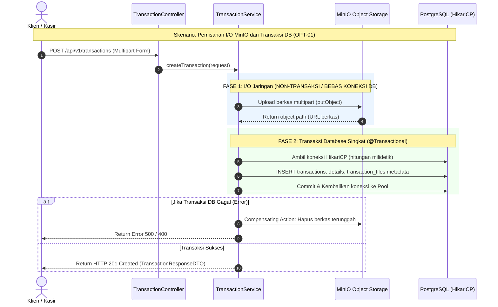

# Katalog Issue: Optimasi Performa Lanjutan (Fase 2)

Dokumen ini berisi spesifikasi teknis dan daftar issue/tiket kerja untuk mengimplementasikan **Rekomendasi Optimasi Performa Fase 2** pada backend **BE Nuy Laundry**, sesuai yang dirumuskan pada [PERFORMANCE_REPORT.md](../reports/PERFORMANCE_REPORT.md) Bagian 7. Dokumen ini ditulis dalam bahasa **high-level, jelas, dan berorientasi aksi** agar mudah dieksekusi oleh *junior developer* maupun agen AI otomatis.

---

## 📌 Ringkasan Masalah & Analisis Teknis (Root Cause)

Berdasarkan hasil evaluasi performa sebelumnya, sistem telah berhasil mengeliminasi N+1 query dan menyeimbangkan HikariCP pool. Namun, terdapat 3 area optimasi tingkat lanjut yang krusial untuk menjaga stabilitas saat beban sistem meningkat di lingkungan produksi:

### 1. Masalah I/O Storage di Dalam Transaksi Database (HikariCP Starvation Risk)
- **Kondisi Saat Ini**: Pada [TransactionServiceImpl.java](../../src/main/java/com/be_nuy_laundry/be_nuy_laundry/application/services/TransactionServiceImpl.java), method `createTransaction` dianotasi `@Transactional`. Di dalam method tersebut, sistem memanggil `transactionFileUseCase.setTransactionFiles(...)` yang melakukan network I/O upload file berukuran beberapa MB secara sinkron ke MinIO (`minioClient.putObject`).
- **Akar Masalah**: Koneksi JDBC dari HikariCP diambil di awal method dan ditahan dalam keadaan aktif (*idle-in-transaction*) selama proses upload berkas melalui jaringan berlangsung. Jika MinIO mengalami perlambatan jaringan atau klien mengunggah berkas multi-MB secara bersamaan, connection pool HikariCP (20 koneksi) akan cepat terkuras (*connection starvation*), memicu antrean (*pending connections*), hingga request lain gagal akibat `ConnectionTimeoutException`.
- **Solusi**: Pisahkan tahap upload I/O berkas ke MinIO di luar transaksi database (*decoupling*). Buka `@Transactional` murni hanya untuk fase persistensi entitas ke database relasional. Jika database gagal menyimpan, jalankan mekanisme kompensasi (*cleanup rollback*) untuk menghapus berkas yang telah terunggah di MinIO.

### 2. Beban Query Berulang pada Master Data yang Bersifat Statis (Paket & Benefit)
- **Kondisi Saat Ini**: Endpoint katalog paket (`GET /api/v1/packages/**`) dan benefit (`GET /api/v1/benefits/**`) diakses sangat sering oleh staf kasir dan klien (read-heavy), namun datanya sangat jarang diubah oleh admin (write-rare). Saat ini, setiap panggilan selalu menembus layer database PostgreSQL.
- **Akar Masalah**: Walaupun latensi per-query relatif cepat (~4-7 ms), beban I/O database dan connection pool terbuang untuk membaca data yang tidak berubah.
- **Solusi**: Terapkan pola **Cache-Aside** menggunakan Redis yang sudah tersedia (`RedisCacheService`). Simpan data daftar dan detail paket/benefit dengan TTL yang wajar (misal 1 jam atau 24 jam), lalu lakukan *cache eviction* otomatis saat admin melakukan operasi mutasi (tambah, ubah, atau hapus paket/benefit).

### 3. Degradasi Performa Pencarian Teks Parsial (`LIKE '%...%'`)
- **Kondisi Saat Ini**: Pencarian pelanggan berdasarkan nama atau alamat (`GET /api/v1/customers?search=...`) menggunakan query SQL `ILIKE '%keyword%'` atau `LIKE '%keyword%'`.
- **Akar Masalah**: Indeks B-Tree standar tidak dapat memanfaatkan indeks jika karakter *wildcard* (`%`) berada di awal kata kunci (*leading wildcard*). Akibatnya, PostgreSQL terpaksa melakukan **Sequential Scan (Seq Scan)** pada seluruh tabel `customers`. Pada data 2.000 baris dampak belum signifikan, namun saat data mencapai 100.000+ pelanggan, waktu respons akan melambat drastis.
- **Solusi**: Tambahkan ekstensi PostgreSQL `pg_trgm` (trigram) dan bangun indeks **GIN (Generalized Inverted Index)** pada kolom pencarian teks. Dengan GIN trigram, pencarian substring `LIKE '%...%'` dapat menggunakan *Bitmap Index Scan* yang sangat cepat dan skalabel.

---

## 🏛️ Matriks & Rencana Arsitektur Fase 2



---

## 🛠️ Daftar Tiket Tugas (Actionable Issues)

| Kode Tiket | Judul Tugas | Prioritas | Estimasi | Target Modul / File Terkait |
| :--- | :--- | :---: | :---: | :--- |
| **OPT-01** | Pemisahan Upload MinIO dari Transaksi Database | **Tinggi** | 2-3 jam | `TransactionServiceImpl`, `TransactionFileServiceImpl` |
| **OPT-02** | Implementasi Cache-Aside Redis untuk Paket & Benefit | **Sedang** | 2 jam | `PackageServiceImpl`, `BenefitServiceImpl`, `RedisCacheService` |
| **OPT-03** | Ekstensi `pg_trgm` & Indeks GIN Pencarian Pelanggan | **Sedang** | 1 jam | Liquibase `014-add-trigram-gin-indexes.yaml` |
| **OPT-04** | Pengujian Regresi & Validasi Metrik Performa | **Tinggi** | 2 jam | `scripts/test_runner.py`, `scripts/perf/load_test.js` |

---

### [OPT-01] Pemisahan Upload MinIO dari Transaksi Database

#### Tujuan
Menghilangkan risiko *connection starvation* pada connection pool HikariCP dengan memastikan koneksi database hanya dibuka saat data entitas siap disimpan, bukan saat berkas sedang diunggah melalui jaringan ke MinIO.

#### Langkah Pengerjaan
1. Buka [TransactionServiceImpl.java](../../src/main/java/com/be_nuy_laundry/be_nuy_laundry/application/services/TransactionServiceImpl.java).
2. Periksa method `createTransaction(TransactionRequestDTO transactionRequest)`.
3. Refaktor alur menjadi 2 fase:
   - **Fase A (Di luar transaksi DB)**:
     - Generate nomor invoice (`TransactionNumberGenerator.generateInvoiceNo()`).
     - Jalankan upload berkas MinIO (`transactionFileUseCase.setTransactionFiles(...)`) tanpa memegang koneksi DB.
   - **Fase B (Di dalam transaksi DB terisolasi)**:
     - Simpan entitas `TransactionModel`, `TransactionDetailModel`, dan `TransactionFileModel` dalam method repository beranotasi transaksi database singkat.
   - **Mekanisme Kompensasi (*Rollback*)**:
     - Bungkus pemanggilan Fase B dengan blok `try-catch`. Jika terjadi kegagalan persistensi database, tangkap exception dan panggil pembersihan berkas MinIO yang terlanjur diunggah, lalu lemparkan kembali exception tersebut.
4. Lakukan hal yang sama pada [TransactionFileServiceImpl.java](../../src/main/java/com/be_nuy_laundry/be_nuy_laundry/application/services/TransactionFileServiceImpl.java) pada method `uploadTransactionFile`:
   - Validasi data & upload file ke MinIO terlebih dahulu.
   - Simpan metadata file ke repository database dalam transaksi terisolasi.

#### Kriteria Lolos (Definition of Done)
- [x] Operasi upload file MinIO tidak dieksekusi di dalam blok `@Transactional` aktif yang menahan koneksi HikariCP.
- [x] Jika simpan transaksi gagal di database, file yang terunggah di MinIO otomatis dibersihkan (*compensating rollback*).
- [x] Seluruh unit test terkait transaksi dan berkas tetap lulus (100%).

---

### [OPT-02] Implementasi Cache-Aside Redis untuk Paket & Benefit

#### Tujuan
Menurunkan beban query baca pada tabel `packages` dan `benefits` ke 0 query saat cache valid, serta mempertahankan respons HTTP di bawah 2 ms.

#### Langkah Pengerjaan
1. Buka [CacheKey.java](../../src/main/java/com/be_nuy_laundry/be_nuy_laundry/common/constant/CacheKey.java).
2. Tambahkan konstanta prefix cache untuk paket dan benefit:
   ```java
   public static final String PACKAGE_LIST = "package:list:";
   public static final String PACKAGE_DETAIL = "package:detail:";
   public static final String BENEFIT_LIST = "benefit:list:";
   public static final String BENEFIT_DETAIL = "benefit:detail:";
   ```
3. Buka [PackageServiceImpl.java](../../src/main/java/com/be_nuy_laundry/be_nuy_laundry/application/services/PackageServiceImpl.java):
   - Inject `RedisCacheService`.
   - Pada method `getAllPackages(...)` dan `getPackageById(...)`, periksa keberadaan data di Redis terlebih dahulu. Jika ada (*cache hit*), kembalikan langsung tanpa query database.
   - Jika tidak ada (*cache miss*), ambil dari database, simpan ke Redis dengan TTL (misal 3.600 detik / 1 jam), lalu kembalikan hasilnya.
   - Pada method mutasi `createPackage`, `updatePackage`, dan `deletePackage`, lakukan *cache eviction* (hapus key list dan detail terkait di Redis).
4. Buka [BenefitServiceImpl.java](../../src/main/java/com/be_nuy_laundry/be_nuy_laundry/application/services/BenefitServiceImpl.java):
   - Terapkan pola Cache-Aside yang sama untuk daftar benefit dan detail benefit.
   - Bersihkan cache saat `createBenefit`, `updateBenefit`, atau `deleteBenefit` dipanggil.
5. Perbarui unit test [PackageServiceImplTest.java](../../src/test/java/com/be_nuy_laundry/be_nuy_laundry/application/services/PackageServiceImplTest.java) dan [BenefitServiceImplTest.java](../../src/test/java/com/be_nuy_laundry/be_nuy_laundry/application/services/BenefitServiceImplTest.java) untuk memvalidasi interaksi cache hit, miss, dan eviction.

#### Kriteria Lolos (Definition of Done)
- [x] Panggilan `GET /api/v1/packages` dan `GET /api/v1/benefits` kedua kali menghasilkan *cache hit* di Redis tanpa query SQL ke PostgreSQL.
- [x] Ketika paket/benefit diubah atau dihapus oleh admin, data di cache otomatis terhapus (*cache eviction*) sehingga pengguna mendapatkan data terbaru.
- [x] Unit test service terkait cache lulus 100%.

---

### [OPT-03] Ekstensi `pg_trgm` & Indeks GIN Pencarian Pelanggan

#### Tujuan
Mengoptimalkan pencarian data pelanggan berbasis teks parsial (*substring search*) agar tidak melakukan sequential scan pada PostgreSQL.

#### Langkah Pengerjaan
1. Buat berkas changelog migrasi Liquibase baru: `src/main/resources/db/changelog/014-add-trigram-gin-indexes.yaml`.
2. Tambahkan changeset untuk mengaktifkan ekstensi PostgreSQL `pg_trgm`:
   ```yaml
   databaseChangeLog:
     - changeSet:
         id: 014-1-enable-pg-trgm-extension
         author: antigravity
         changes:
           - sql:
               sql: CREATE EXTENSION IF NOT EXISTS pg_trgm;
   ```
3. Tambahkan changeset untuk membuat indeks GIN pada kolom `name` dan `address` di tabel `customers`:
   ```yaml
     - changeSet:
         id: 014-2-add-gin-trigram-indexes-customers
         author: antigravity
         changes:
           - sql:
               sql: CREATE INDEX IF NOT EXISTS idx_customers_name_trgm ON customers USING gin (lower(name) gin_trgm_ops);
           - sql:
               sql: CREATE INDEX IF NOT EXISTS idx_customers_address_trgm ON customers USING gin (lower(address) gin_trgm_ops);
   ```
4. Daftarkan changelog `014-add-trigram-gin-indexes.yaml` ke [db.changelog-master.yaml](../../src/main/resources/db/changelog/db.changelog-master.yaml).
5. Jalankan aplikasi atau tes integrasi untuk memverifikasi migrasi Liquibase berhasil dieksekusi tanpa error.

#### Kriteria Lolos (Definition of Done)
- [x] Ekstensi `pg_trgm` aktif pada basis data PostgreSQL.
- [x] Indeks GIN `idx_customers_name_trgm` dan `idx_customers_address_trgm` terdaftar di tabel `customers`.
- [x] Migrasi Liquibase berjalan sukses saat startup tanpa konflik.

---

### [OPT-04] Pengujian Regresi & Validasi Metrik Performa

#### Tujuan
Memastikan seluruh optimasi Fase 2 tidak menyebabkan regresi fungsional dan meningkatkan metrik latensi serta ketahanan koneksi pool sistem.

#### Langkah Pengerjaan
1. Jalankan unit test menyeluruh:
   ```bash
   ./mvnw clean test
   ```
   Pastikan seluruh 230+ test lulus 100%.
2. Jalankan automated E2E API test runner:
   ```bash
   python3 scripts/test_runner.py
   ```
   Pastikan seluruh 54 skenario pengujian lulus 100%.
3. Jalankan pengujian beban k6:
   ```bash
   k6 run --summary-export=scripts/perf/load_test_phase2_summary.json scripts/perf/load_test.js
   ```
4. Perbarui [PERFORMANCE_REPORT.md](../reports/PERFORMANCE_REPORT.md) dengan mencatat hasil evaluasi Fase 2.

#### Kriteria Lolos (Definition of Done)
- [x] Unit test suite lulus 100% tanpa kegagalan (233/233 lulus).
- [x] Automated API test runner lulus 100% (54/54 test cases).
- [x] Load test k6 lulus dengan error rate 0.00% dan read p95 < 300 ms (aktual: 127.04 ms).
- [x] Dokumen laporan diperbarui dengan temuan dan metrik valid.

---

## ✅ Checklist Definition of Done (DoD) Global

- [x] **OPT-01**: Upload berkas MinIO terpisah dari transaksi database (`idle-in-transaction` tereliminasi).
- [x] **OPT-02**: Redis cache-aside aktif pada paket dan benefit dengan mekanisme eviction yang tepat.
- [x] **OPT-03**: Ekstensi `pg_trgm` dan indeks GIN terpasang melalui Liquibase changelog 014.
- [x] **OPT-04**: Pengujian fungsional dan beban memvalidasi nol error (100% lulus).
