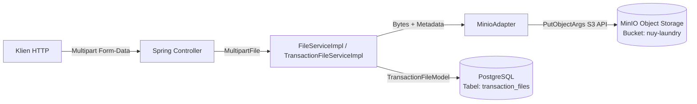
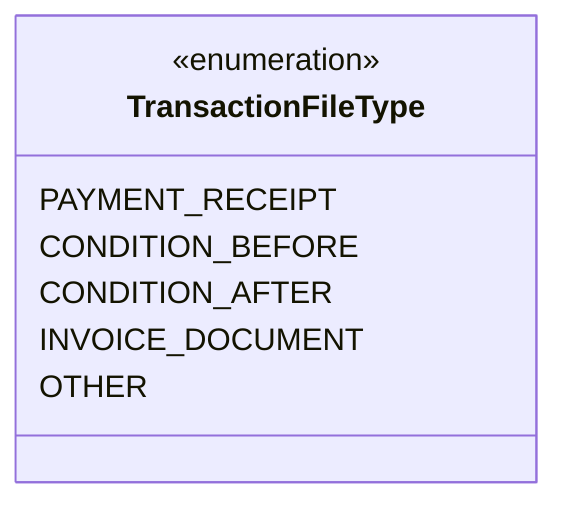
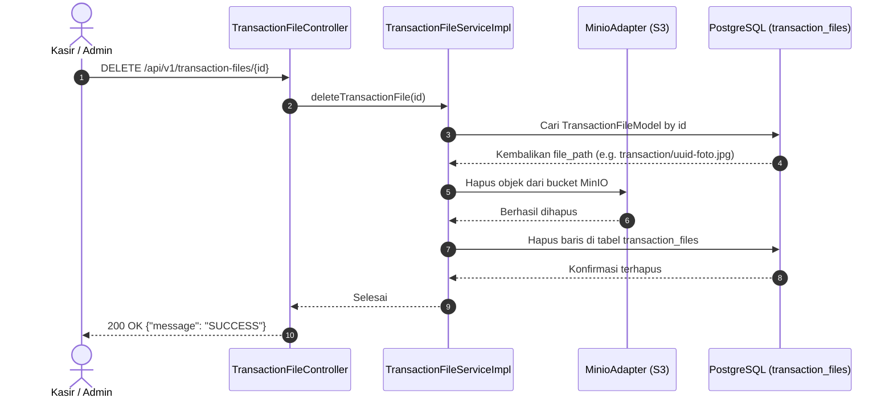

# 04. Manajemen Berkas (File Management)

Dokumen ini menjelaskan arsitektur manajemen berkas (*file storage*), integrasi dengan MinIO Object Storage, batasan ukuran & tipe MIME, struktur multipart request, dan siklus hidup berkas transaksi pada sistem **BE Nuy Laundry**.

---

## 1. Arsitektur Penyimpanan: MinIO Object Storage

Sistem menggunakan **MinIO Object Storage** (kompatibel penuh dengan Amazon S3 API) sebagai media penyimpanan berkas biner (*binary objects*). Database PostgreSQL hanya menyimpan metadata berkas (nama asli, path objek, tipe MIME, ukuran berkas, dan relasi transaksi).



---

## 2. Batasan & Aturan Validasi Berkas

### A. Konfigurasi Batas Ukuran (File Size Limits)
Dikonfigurasi dalam [application.properties](../../src/main/resources/application.properties):
```properties
spring.servlet.multipart.max-file-size=3MB
spring.servlet.multipart.max-request-size=15MB
spring.servlet.multipart.file-size-threshold=1MB
```
- Maksimum ukuran per berkas: **3 Megabytes (3MB)**.
- Maksimum total payload request multipart: **15 Megabytes (15MB)** (mendukung pengunggahan simultan beberapa foto transaksi).
- Threshold buffer disk: **1 Megabyte (1MB)** (berkas di atas 1MB di-buffer sementara ke disk sistem untuk melindungi memori heap JVM dari lonjakan memori).
- Pelanggaran batas memicu `MaxUploadSizeExceededException` yang ditangkap oleh [GlobalExceptionHandler](../../src/main/java/com/be_nuy_laundry/be_nuy_laundry/presentation/advices/GlobalExceptionHandler.java) dan dikembalikan sebagai HTTP 400 Bad Request.

### B. Validasi Tipe Berkas (`@ValidImage`)
Divalidasi menggunakan custom annotation validator [FileValidator.java](../src/main/java/com/be_nuy_laundry/be_nuy_laundry/presentation/validations/FileValidator.java). Hanya tipe MIME berikut yang diperbolehkan:
- `image/jpeg`
- `image/jpg`
- `image/png`
- `image/webp`

> [!IMPORTANT]
> **Catatan Khusus untuk Berkas Invoice Dokumen**:
> Pada [TransactionController.java](../src/main/java/com/be_nuy_laundry/be_nuy_laundry/presentation/controllers/TransactionController.java#L40), parameter `invoiceDocumentFile` dianotasikan dengan `@ValidImage(required = false)`. Akibatnya, dokumen berupa `application/pdf` akan ditolak oleh validator saat ini. Invoice harus diunggah dalam format gambar yang valid.

---

## 3. Klasifikasi & Lokasi Folder di MinIO

Sistem mengelompokkan berkas ke dalam direktori (*prefix*) spesifik di dalam bucket `nuy-laundry` menggunakan konstanta [MinIoConstant.java](../src/main/java/com/be_nuy_laundry/be_nuy_laundry/common/constant/MinIoConstant.java):

| Kategori Berkas | Direktori Bucket | Pola Nama Berkas di MinIO | Sumber Pengunggah |
| :--- | :--- | :--- | :--- |
| **Foto Profil Pengguna** | `user/` | `user/{UUID}-{originalFileName}` | `UserController` (Create/Update User) |
| **Foto Paket Layanan** | `packages/` | `packages/{UUID}-{originalFileName}` | `PackageController` (Create/Update Package) |
| **Berkas Transaksi Cucian** | `transaction/` | `transaction/{invoiceNo}_{fileType}_{UUID}-{fileName}` | `TransactionController` & `TransactionFileController` |
| **Berkas Umum (General)** | `general/` | `general/{UUID}-{originalFileName}` | Default fallback di `FileServiceImpl` |

---

## 4. Kategori Berkas Transaksi (`TransactionFileType`)

Setiap berkas yang diunggah ke dalam transaksi diklasifikasikan ke dalam enum [TransactionFileType](../src/main/java/com/be_nuy_laundry/be_nuy_laundry/infrastructure/internal/database/entity/enumrated/TransactionFileType.java):



1. **`PAYMENT_RECEIPT`**: Bukti transfer atau struk pembayaran uang muka/lunas.
2. **`CONDITION_BEFORE`**: Foto kondisi fisik pakaian kotor saat diserahkan (misal ada sobekan, noda membandel, atau kancing hilang) sebagai bukti perlindungan bagi pihak laundry.
3. **`CONDITION_AFTER`**: Foto pakaian setelah selesai dicuci, dikeringkan, dan disetrika rapi.
4. **`INVOICE_DOCUMENT`**: Foto faktur atau nota fisik pesanan.
5. **`OTHER`**: Berkas pendukung lain yang relevan.

---

## 5. Metadata Berkas pada Basis Data (`transaction_files`)

Struktur tabel `transaction_files` pada basis data PostgreSQL menyimpan informasi:
- `id`: Primary key (UUID string).
- `file_path`: Path lengkap objek di MinIO (misal `transaction/TRX-SEN-1234_CONDITION_BEFORE_abc.jpg`).
- `file_name`: Nama asli berkas dari perangkat klien.
- `content_type`: MIME type berkas (e.g. `image/jpeg`).
- `file_size`: Ukuran berkas dalam bytes.
- `file_type`: Nilai enum dari `TransactionFileType`.
- `transaction_id`: Foreign key ke tabel `transactions` (`ON DELETE CASCADE`).

---

## 6. Alur Penghapusan Berkas (File Deletion Flow)

Sistem menjamin konsistensi antara basis data relasional dan penyimpanan objek MinIO:



### Penghapusan Massal (Batch Deletion):
Endpoint `DELETE /api/v1/transaction-files/list` menerima daftar ID berkas (`TransactionFileDeleteRequestDTO`), mengumpulkan seluruh `file_path`, dan memanggil method `MinioClient.removeObjects` untuk penghapusan efisien dalam satu request batch.

---

## 7. Pemisahan I/O Storage dari Transaksi Database (MinIO Decoupling)

Pada method pembuatan transaksi ([TransactionServiceImpl.java](../../src/main/java/com/be_nuy_laundry/be_nuy_laundry/application/services/TransactionServiceImpl.java)) dan unggah berkas ([TransactionFileServiceImpl.java](../../src/main/java/com/be_nuy_laundry/be_nuy_laundry/application/services/TransactionFileServiceImpl.java)):
1. **Pemisahan Konteks Transaksi**:
   - I/O jaringan MinIO (`putObject`) dieksekusi terlebih dahulu di luar transaksi database relasional (`@Transactional`).
   - Koneksi HikariCP hanya dipinjam selama persistensi baris database SQL berlangsung (hitungan milidetik), menghilangkan risiko *connection pool starvation* saat pengunggahan berkas besar.
2. **Aksi Kompensasi (*Compensating Rollback*)**:
   - Jika persistensi database relasional gagal melempar exception, blok `try-catch` secara otomatis memanggil `fileUseCase.deleteObjects(...)` untuk menghapus berkas yang telah terunggah di MinIO, mencegah terjadinya berkas yatim (*orphaned objects*).

---

## 8. Status Pengunduhan & Pratinjau Berkas (Download Mechanism)

- **Implementasi Layanan**: [FileServiceImpl.java](../../src/main/java/com/be_nuy_laundry/be_nuy_laundry/application/services/FileServiceImpl.java) memiliki method `download(String fileName)` yang mengembalikan representasi array byte `byte[]`.
- **Implementasi Controller**: [FileController.java](../../src/main/java/com/be_nuy_laundry/be_nuy_laundry/presentation/controllers/FileController.java) saat ini merupakan kelas kosong tanpa mapping HTTP REST. Oleh karena itu, klien saat ini melihat atau mengunduh berkas dengan mengakses langsung MinIO Console (`http://localhost:9001`) atau via endpoint URL MinIO storage publik jika bucket diset ke mode read-only.
