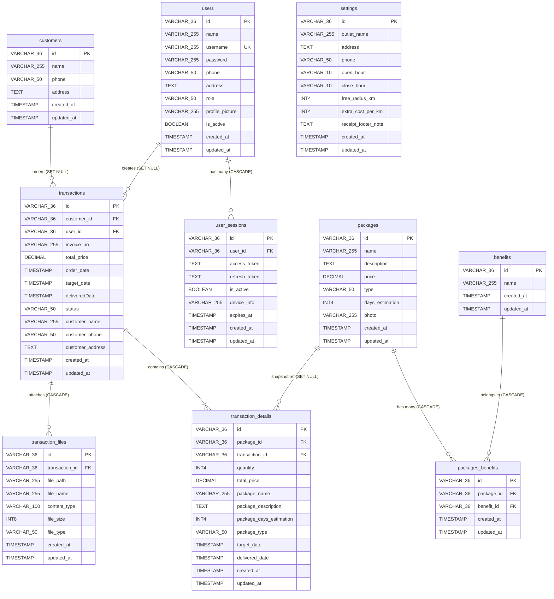

# 05. Basis Data & Kamus Data (Database & Data Dictionary)

Dokumen ini menyediakan spesifikasi lengkap skema basis data PostgreSQL, migrasi Liquibase, diagram hubungan antar entitas (*Entity-Relationship Diagram* / ERD), serta kamus data (*data dictionary*) untuk sistem **BE Nuy Laundry**.

---

## 1. Mekanisme Migrasi Skema (Liquibase)

Sistem menggunakan **Liquibase** untuk version control skema basis data. Master changelog dikonfigurasi pada [application.properties](../../src/main/resources/application.properties):
- File master: `classpath:db/changelog/db.changelog-master.yaml`
- Seluruh tabel, tipe data kolom, foreign key constraint, dan indeks dibuat secara deterministik tanpa mengandalkan fitur `ddl-auto` bawaan Hibernate (`spring.jpa.hibernate.ddl-auto=none`).

### Katalog File Changelog:
| No | File Changelog | Deskripsi Perubahan |
| :---: | :--- | :--- |
| **001** | `001-create-users.yaml` | Pembuatan tabel `users` dan constraint unik `username`. |
| **002** | `002-create-customers.yaml` | Pembuatan tabel `customers`. |
| **003** | `003-create-packages.yaml` | Pembuatan tabel master `packages`. |
| **004** | `004-create-benefits.yaml` | Pembuatan tabel master `benefits`. |
| **005** | `005-create-packages_benefits.yaml` | Pembuatan tabel relasi many-to-many `packages_benefits`. |
| **006** | `006-create-transactions.yaml` | Pembuatan tabel header `transactions`. |
| **007** | `007-create-transaction_details.yaml` | Pembuatan tabel rincian `transaction_details`. |
| **008** | `008-create-transaction_files.yaml` | Pembuatan tabel metadata berkas `transaction_files`. |
| **009** | `009-create-user_sessions.yaml` | Pembuatan tabel sesi login `user_sessions`. |
| **010** | `010-add-foreign-keys.yaml` | Penambahan relasi foreign key constraint antar tabel. |
| **011** | `011-add-is-active-users.yaml` | Penambahan kolom `is_active` pada tabel `users`. |
| **012** | `012-add-photo-packages.yaml` | Penambahan kolom `photo` pada tabel `packages`. |
| **013** | `013-add-performance-indexes.yaml` | Penambahan 10 indeks B-Tree foreign key & filter performa (PERF-06). |
| **014** | `014-add-trigram-gin-indexes.yaml` | Pengaktifan ekstensi `pg_trgm` dan indeks GIN trigram `customers(name, address)` (OPT-03). |
| **015** | `015-create-settings.yaml` | Pembuatan tabel konfigurasi outlet & operasional `settings`. |

---

## 2. Entity-Relationship Diagram (ERD)

---

## 3. Kamus Data Lengkap (Data Dictionary)

### 3.1. Tabel `users`
Menyimpan akun pengguna sistem (karyawan, admin, super admin).

| Kolom | Tipe Data | Nullable | Keterangan / Constraint |
| :--- | :--- | :---: | :--- |
| `id` | VARCHAR(36) | NO | Primary Key (UUID String). |
| `name` | VARCHAR(255) | NO | Nama lengkap pengguna. |
| `username` | VARCHAR(255) | NO | Username unik untuk login (`UNIQUE`). |
| `password` | VARCHAR(255) | NO | Hash kata sandi terenkripsi BCrypt. |
| `phone` | VARCHAR(50) | NO | Nomor telepon aktif. |
| `address` | TEXT | YES | Alamat tempat tinggal pengguna. |
| `role` | VARCHAR(50) | NO | Hak akses: `SUPER_ADMIN`, `ADMIN`, `STAFF` (Default: `STAFF`). |
| `profile_picture` | VARCHAR(255) | YES | Path berkas foto profil di MinIO Storage. |
| `is_active` | BOOLEAN | NO | Status keaktifan akun (Default: `true`). |
| `created_at` | TIMESTAMP | NO | Waktu pembuatan baris data. |
| `updated_at` | TIMESTAMP | NO | Waktu pembaruan terakhir data. |

---

### 3.2. Tabel `user_sessions`
Menyimpan data sesi aktif pengguna untuk pelacakan token dan *revocation*.

| Kolom | Tipe Data | Nullable | Keterangan / Constraint |
| :--- | :--- | :---: | :--- |
| `id` | VARCHAR(36) | NO | Primary Key (UUID Session ID). |
| `user_id` | VARCHAR(36) | NO | FK ke `users(id)` (`ON DELETE CASCADE`). |
| `access_token` | TEXT | NO | Nilai JWT Access Token yang diterbitkan. |
| `refresh_token` | TEXT | NO | Nilai JWT Refresh Token yang diterbitkan. |
| `is_active` | BOOLEAN | NO | Status sesi aktif/dicabut (Default: `true`). |
| `device_info` | VARCHAR(255) | YES | Informasi perangkat klien / user agent. |
| `expires_at` | TIMESTAMP | NO | Tanggal & waktu kedaluwarsa sesi (+7 hari). |
| `created_at` | TIMESTAMP | NO | Waktu pembuatan sesi. |
| `updated_at` | TIMESTAMP | NO | Waktu pembaruan sesi. |

---

### 3.3. Tabel `customers`
Menyimpan data master pelanggan binatu.

| Kolom | Tipe Data | Nullable | Keterangan / Constraint |
| :--- | :--- | :---: | :--- |
| `id` | VARCHAR(36) | NO | Primary Key (UUID String). |
| `name` | VARCHAR(255) | NO | Nama lengkap pelanggan. |
| `phone` | VARCHAR(50) | NO | Nomor telepon / WhatsApp pelanggan. |
| `address` | TEXT | YES | Alamat tempat tinggal / penjemputan. |
| `created_at` | TIMESTAMP | NO | Waktu pencatatan pelanggan. |
| `updated_at` | TIMESTAMP | NO | Waktu pembaruan data pelanggan. |

---

### 3.4. Tabel `packages`
Menyimpan katalog paket layanan pencucian laundry.

| Kolom | Tipe Data | Nullable | Keterangan / Constraint |
| :--- | :--- | :---: | :--- |
| `id` | VARCHAR(36) | NO | Primary Key (UUID String). |
| `name` | VARCHAR(255) | NO | Nama paket (e.g. Cuci Komplit Kilat). |
| `description` | TEXT | NO | Deskripsi detail layanan paket. |
| `price` | DECIMAL(19,2) | NO | Harga paket per satuan / per kilogram. |
| `type` | VARCHAR(50) | NO | Satuan perhitungan: `WEIGHT` (Kg) atau `PCS` (Satuan). |
| `days_estimation` | INT4 | NO | Estimasi durasi pengerjaan dalam hari (e.g. 1, 2, 3). |
| `photo` | VARCHAR(255) | YES | Path berkas foto paket di MinIO Storage. |
| `created_at` | TIMESTAMP | NO | Waktu pembuatan paket. |
| `updated_at` | TIMESTAMP | NO | Waktu pembaruan paket. |

---

### 3.5. Tabel `benefits` & `packages_benefits`
- **`benefits`**: Menyimpan master benefit (contoh: Free Parfum, Anti Bakteri).
- **`packages_benefits`**: Tabel perantara *many-to-many* antara paket dan benefit.

| Tabel | Kolom | Tipe Data | Keterangan |
| :--- | :--- | :--- | :--- |
| `benefits` | `id` | VARCHAR(36) | Primary Key. |
| `benefits` | `name` | VARCHAR(255) | Nama manfaat layanan. |
| `packages_benefits` | `package_id` | VARCHAR(36) | FK ke `packages(id)` (`ON DELETE CASCADE`). |
| `packages_benefits` | `benefit_id` | VARCHAR(36) | FK ke `benefits(id)` (`ON DELETE CASCADE`). |

---

### 3.6. Tabel `transactions`
Menyimpan transaksi header pesanan laundry.

| Kolom | Tipe Data | Nullable | Keterangan / Constraint |
| :--- | :--- | :---: | :--- |
| `id` | VARCHAR(36) | NO | Primary Key (UUID String). |
| `customer_id` | VARCHAR(36) | YES | FK ke `customers(id)` (`ON DELETE SET NULL`). |
| `user_id` | VARCHAR(36) | YES | FK ke `users(id)` petugas/kasir (`ON DELETE SET NULL`). |
| `invoice_no` | VARCHAR(255) | NO | Nomor invoice unik otomatis. |
| `total_price` | DECIMAL(19,2) | NO | Total akumulasi harga seluruh detail transaksi. |
| `order_date` | TIMESTAMP | NO | Tanggal & waktu pesanan diterima. |
| `target_date` | TIMESTAMP | NO | Estimasi tanggal pesanan harus selesai. |
| `deliveredDate` | TIMESTAMP | YES | Tanggal pesanan diserahkan ke pelanggan (*camelCase name*). |
| `status` | VARCHAR(50) | NO | Status pesanan: `IN_PROGRESS`, `DONE`, `CANCELED`. |
| `customer_name` | VARCHAR(255) | NO | Snapshot nama pelanggan saat order dibuat. |
| `customer_phone` | VARCHAR(50) | YES | Snapshot nomor telepon pelanggan saat order dibuat. |
| `customer_address`| TEXT | YES | Snapshot alamat pelanggan saat order dibuat. |
| `created_at` | TIMESTAMP | NO | Waktu pembuatan transaksi. |
| `updated_at` | TIMESTAMP | NO | Waktu pembaruan transaksi. |

---

### 3.7. Tabel `transaction_details`
Menyimpan rincian item pesanan laundry dalam satu transaksi.

| Kolom | Tipe Data | Nullable | Keterangan / Constraint |
| :--- | :--- | :---: | :--- |
| `id` | VARCHAR(36) | NO | Primary Key (UUID String). |
| `package_id` | VARCHAR(36) | YES | FK ke `packages(id)` (`ON DELETE SET NULL`). |
| `transaction_id`| VARCHAR(36) | NO | FK ke `transactions(id)` (`ON DELETE CASCADE`). |
| `quantity` | INT4 | NO | Jumlah item / berat pakaian (kg). |
| `total_price` | DECIMAL(19,2) | NO | Subtotal: `quantity * price`. |
| `package_name` | VARCHAR(255) | NO | Snapshot nama paket saat order. |
| `package_description` | TEXT | NO | Snapshot deskripsi paket saat order. |
| `package_days_estimation` | INT4 | NO | Snapshot durasi hari paket saat order. |
| `package_type` | VARCHAR(50) | NO | Snapshot tipe paket: `WEIGHT` atau `PCS`. |
| `target_date` | TIMESTAMP | NO | Estimasi tanggal selesai spesifik item ini. |
| `delivered_date`| TIMESTAMP | YES | Tanggal item selesai diserahkan. |
| `created_at` | TIMESTAMP | NO | Waktu pembuatan detail. |
| `updated_at` | TIMESTAMP | NO | Waktu pembaruan detail. |

---

### 3.8. Tabel `transaction_files`
Menyimpan berkas lampiran pendukung transaksi.

| Kolom | Tipe Data | Nullable | Keterangan / Constraint |
| :--- | :--- | :---: | :--- |
| `id` | VARCHAR(36) | NO | Primary Key (UUID String). |
| `transaction_id`| VARCHAR(36) | NO | FK ke `transactions(id)` (`ON DELETE CASCADE`). |
| `file_path` | VARCHAR(255) | NO | Path objek di MinIO (e.g. `transaction/...`). |
| `file_name` | VARCHAR(255) | NO | Nama asli berkas klien. |
| `content_type` | VARCHAR(100) | NO | MIME Type (e.g. `image/jpeg`). |
| `file_size` | INT8 | NO | Ukuran berkas dalam bytes. |
| `file_type` | VARCHAR(50) | NO | Enum: `PAYMENT_RECEIPT`, `CONDITION_BEFORE`, `CONDITION_AFTER`, `INVOICE_DOCUMENT`, `OTHER`. |
| `created_at` | TIMESTAMP | NO | Waktu upload berkas. |
| `updated_at` | TIMESTAMP | NO | Waktu pembaruan rekaman. |

---

### 3.9. Tabel `settings`
Menyimpan konfigurasi profil outlet, jam operasional, radius antar-jemput, dan catatan footer struk.

| Kolom | Tipe Data | Nullable | Keterangan / Constraint |
| :--- | :--- | :---: | :--- |
| `id` | VARCHAR(36) | NO | Primary Key (UUID String). |
| `outlet_name` | VARCHAR(255) | NO | Nama resmi outlet laundry. |
| `address` | TEXT | YES | Alamat lengkap outlet fisik. |
| `phone` | VARCHAR(50) | YES | Nomor telepon / kontak outlet. |
| `open_hour` | VARCHAR(10) | YES | Jam buka operasional (contoh: `07:00`). |
| `close_hour` | VARCHAR(10) | YES | Jam tutup operasional (contoh: `21:00`). |
| `free_radius_km` | INT4 | YES | Radius gratis antar-jemput cucian dalam kilometer. |
| `extra_cost_per_km` | INT4 | YES | Biaya tambahan per kilometer di luar radius gratis. |
| `receipt_footer_note` | TEXT | YES | Catatan penutup yang dicetak pada struk / nota pelanggan. |
| `created_at` | TIMESTAMP | NO | Waktu inisialisasi pengaturan. |
| `updated_at` | TIMESTAMP | NO | Waktu terakhir konfigurasi diperbarui. |
